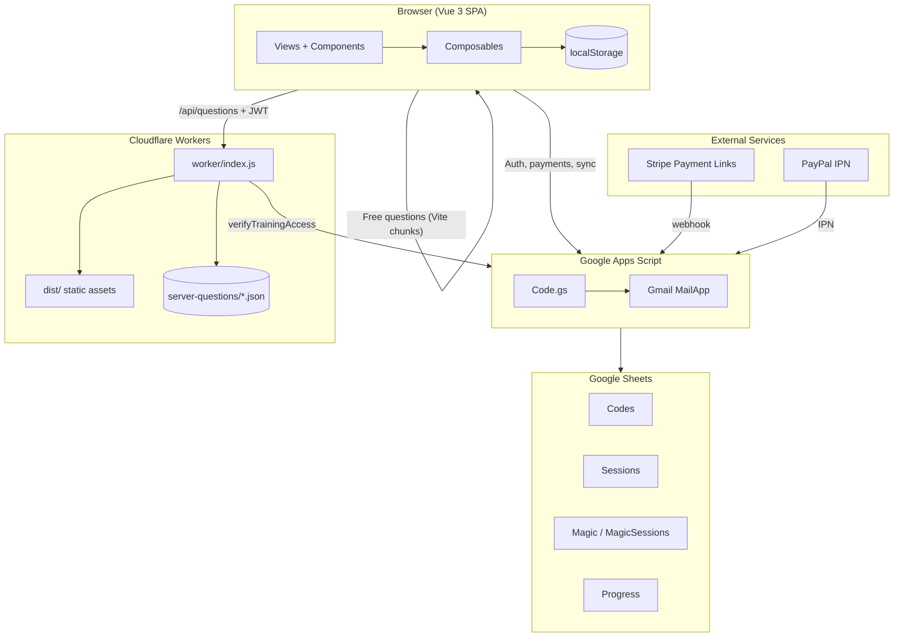

# Архитектура системы

## Обзор компонентов



---

## Слои приложения

### 1. Frontend (Vue 3 SPA)

| Аспект | Реализация |
| ------ | ---------- |
| Entry | `src/main.js` → `App.vue` |
| Routing | Hash mode (`createWebHashHistory`) — без server-side rewrites |
| State | Composition API composables (singleton reactive objects) |
| Persistence | `localStorage` через `useStorage.js` |
| i18n | Статические строки DE/RU/EN в `src/i18n/` |
| Styling | Единый `src/styles/main.css` |

**Ключевые composables:**

| Composable | Назначение |
| ---------- | ---------- |
| `useAuth.js` | Magic-link сессии (365 дней sliding) |
| `usePremium.js` | Entitlements, bootstrap, grace |
| `useProgressSync.js` | Cross-device XP/streak sync |
| `useFreeDailyLimit.js` | 10 мин/день для free tier |
| `useStreak.js` / `useXp.js` | Gamification |

### 2. Cloudflare Worker

Файл: `worker/index.js`

| Endpoint | Auth | Назначение |
| -------- | ---- | ---------- |
| `GET /api/health` | Нет | Ping GAS, latency |
| `GET /api/questions` | Premium JWT или GAS verify | Shuffled questions из bundled JSON |
| `GET /*` | Нет | SPA assets из `dist/` |

Конфигурация: `wrangler.toml` — `run_worker_first = true`, SPA fallback.

### 3. Google Apps Script Backend

Файл: `apps-script/Code.gs` (~1700 строк, monolith)

| Триггер | HTTP | Действие |
| ------- | ---- | -------- |
| Stripe webhook | POST `?action=stripeWebhook&secret=…` | Генерация activation code + email |
| PayPal IPN | POST `?action=paypalIpn&secret=…` | Аналогично |
| validateCode | GET | Проверка кода, 2h session token |
| validateMagicToken | GET | Magic-link login |
| requestMagicLink | GET | Отправка login email |
| refreshMagicSession | POST | Sliding expiry + entitlements |
| verifyTrainingAccess | POST | Premium check для Worker |
| load/saveProgressByEmail | POST | Cross-device sync |

### 4. Хранилище данных

| Хранилище | Данные | Ограничения |
| --------- | ------ | ----------- |
| Google Sheets | Codes, Sessions, Magic, Progress | 10M ячеек, нет транзакций, row scan |
| localStorage | XP, streak, codes, grace, locale | 5–10 MB, только клиент |
| Worker memory | Rate limit buckets, level cache | Сброс при cold start |
| Bundled JSON | Premium questions (~3 MB) | Рост с question bank |

---

## Потоки данных (End-to-End)

### Free training

```
User → Landing → Trainer (?mode=free)
  → import.meta.glob lazy load MD chunk
  → queue.js (shuffle + repeat-on-wrong)
  → localStorage (XP, streak, daily limit)
```

### Premium purchase

```
User → Premium page → Stripe Payment Link
  → Stripe webhook → GAS → Codes sheet + activation email
  → User clicks ?activate=CODE or enters code
  → GAS validateCode → 2h session + device binding
  → bootstrapEntitlements() → isPremium = true
```

### Premium training (topic mode)

```
User → Trainer (?topic=X&mode=premium)
  → usePremium.ensureTrainingJwt() → GAS verifyTrainingAccess
  → GAS returns 30-min HMAC JWT
  → fetch /api/questions?trainingJwt=…
  → Worker verifies JWT locally (no GAS round-trip)
  → Returns shuffled questions from server-questions/*.json
```

### Cross-device progress

```
Login (magic-link) → pullProgressFromServer()
  → merge with local XP/streak
  → scheduleProgressPush() on changes (debounced)
  → GAS saveProgressByEmail → Progress sheet
```

---

## Точки отказа (Single Points of Failure)

| Компонент | Последствие отказа | Mitigation (текущая) |
| --------- | ------------------ | -------------------- |
| **Google Apps Script** | Нет login, payments, sync, premium verify | 72h grace, retries, training JWT cache |
| **Google Sheets** | Все backend-данные недоступны | Нет (hard SPOF) |
| **Gmail (script owner)** | Нет activation/magic-link emails | Нет fallback |
| **Cloudflare Worker** | Premium API down | Free mode работает; SPA может кэшироваться |
| **Stripe/PayPal** | Нет новых покупок | Существующие codes работают |

---

## Build & Deploy Pipeline

```
npm run build
  ├── dictionary:build     → src/data/dictionary/*.json
  ├── questions:export-server → server-questions/*.json
  └── vite build           → dist/ (~52 MB, 11k chunks)

npm run deploy
  └── wrangler deploy      → Cloudflare Worker + assets

GAS (отдельно, вручную):
  Copy Code.gs → script.google.com → Deploy new version
```

**Проблема:** два независимых deploy target без единого CI/CD pipeline.

---

## Зависимости между конфигами

Следующие значения **должны совпадать** между файлами:

| Параметр | Файлы |
| -------- | ----- |
| `SCRIPT_URL` | `wrangler.toml`, `src/data/payment.js` |
| `TRAINING_JWT_SECRET` / `WEBHOOK_SECRET` | `wrangler.toml`, `apps-script/Code.gs` |
| `APP_BASE_URL` | `apps-script/Code.gs`, `src/data/payment.js` |
| `STRIPE_AMOUNT_MAP` | `apps-script/Code.gs`, `src/data/payment.js` |

Ручная синхронизация — источник drift-ошибок при деплое.
