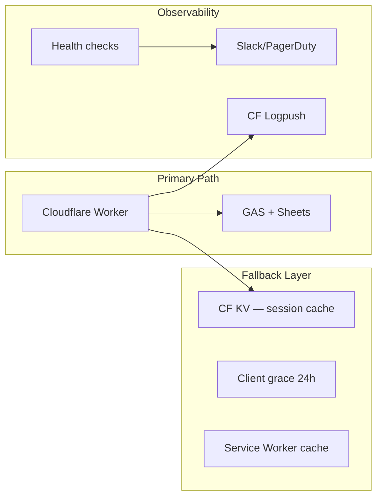

# Отказоустойчивость

## Текущие механизмы resilience

### 1. API Client Retries

**Файл:** `src/utils/api.js`

```
getJson/postJson → up to 2 retries on transient errors
Backoff: 700ms × (attempt + 1)
Timeout: 35s for magic-link request
```

Transient errors определяются в `backendGrace.js:isTransientBackendError()`:
- Network failures, timeouts, 5xx
- Empty/invalid backend response
- **NOT** transient: 403, invalid token, device limit

### 2. Entitlement Grace Period

**Файл:** `src/utils/backendGrace.js`

| Parameter | Value |
| --------- | ----- |
| Grace duration | **72 hours** |
| Storage | localStorage (`lzd_entitlement_grace`) |
| Trigger | GAS unreachable during bootstrapEntitlements() |

**Поведение:**
- UI показывает Premium features
- `backendDegraded.active = true` + warning message
- Premium training через Worker **всё равно требует** valid JWT (grace не помогает без cached JWT)

### 3. Training JWT Cache

**Файлы:** `usePremium.js`, `worker/index.js`

- GAS выдаёт 30-min HMAC JWT при `verifyTrainingAccess`
- Worker проверяет JWT локально — **не нужен GAS** на каждый question fetch
- JWT хранится in-memory (не persisted) — при page reload нужен новый GAS call

### 4. Health Monitoring

**CI:** `.github/workflows/backend-health.yml`
- Cron: hourly
- Script: `npm run backend:verify`
- Checks: GAS + Worker `/api/health`

**Gap:** Нет alerting при failure (только GitHub Actions notification).

### 5. Demo Mode Fallback

**Файл:** `src/data/payment.js` — `SCRIPT_URL = ''`

При пустом SCRIPT_URL:
- Все backend features disabled
- Local prefix activation (`PREMIUM_*`, `BASIS_*`)
- Полностью offline-capable

---

## Failure Scenarios & Impact

### Scenario 1: GAS полностью недоступен

| Feature | Impact | Fallback |
| ------- | ------ | -------- |
| New purchases | 🔴 Blocked | — |
| Magic-link login | 🔴 Blocked | Existing session works |
| Code activation | 🔴 Blocked | — |
| Premium training | 🟡 Degraded | Works if valid JWT in memory |
| Free training | ✅ Works | Fully client-side |
| Progress sync | 🔴 Blocked | Local data preserved |
| UI Premium status | 🟡 Grace 72h | Warning banner |

### Scenario 2: Google Sheets quota exceeded

Same as GAS down — Sheets is the only data store.

### Scenario 3: Cloudflare Worker down

| Feature | Impact | Fallback |
| ------- | ------ | -------- |
| SPA loading | 🔴 Blocked | Browser cache may help |
| Premium API | 🔴 Blocked | Free mode if SPA loads |
| Static assets | 🔴 Blocked | CDN cache TTL dependent |

### Scenario 4: Gmail sending limit (100/day)

| Feature | Impact | Fallback |
| ------- | ------ | -------- |
| Activation emails | 🔴 Blocked after 100 | Manual code generation |
| Magic-link emails | 🔴 Blocked | User cannot login |
| Contact form | 🔴 Blocked | — |

**Severity:** HIGH for growth scenarios.

### Scenario 5: Stripe/PayPal outage

| Feature | Impact | Fallback |
| ------- | ------ | -------- |
| New purchases | 🔴 Blocked | Existing codes work |
| Webhook delivery | 🟡 Delayed | Stripe retries webhooks |

### Scenario 6: Client localStorage cleared

| Feature | Impact | Fallback |
| ------- | ------ | -------- |
| XP/Streak | 🔴 Lost locally | Restored from server if logged in |
| Premium codes | 🟡 Lost locally | Re-enter code or magic-link login |
| Grace snapshot | 🔴 Lost | Need server re-validation |

---

## Resilience Gaps

| Gap | Severity | Recommendation |
| --- | -------- | -------------- |
| No alerting on health check failure | HIGH | PagerDuty / Slack webhook from GitHub Actions |
| No GAS backup/redundancy | HIGH | Secondary backend or queue |
| Training JWT not persisted | MEDIUM | Secure sessionStorage with short TTL |
| No offline mode indicator | LOW | Service Worker + offline banner |
| No automated GAS redeploy | MEDIUM | clasp CI or manual runbook |
| Single Gmail account for all emails | HIGH | Workspace or transactional email service |
| No database backups | HIGH | Scheduled Sheets export to Drive/R2 |

---

## Recommended Resilience Architecture (target)



---

## RTO/RPO Estimates (текущие)

| Metric | Current | Target |
| ------ | ------- | ------ |
| **RTO** (Recovery Time) | Manual intervention, 1–24h | < 1h automated |
| **RPO** (Recovery Point) | Last Sheets state, no backups | < 1h with scheduled backup |
| **MTTR** (Mean Time to Repair) | Unknown (no incident log) | Track in postmortems |

---

## Incident Response Runbook (draft)

### GAS returning 403

1. Check Apps Script deployment: "Execute as: Me", "Anyone"
2. Re-authorize OAuth scopes in script editor
3. Verify SCRIPT_URL matches deployed URL

### GAS timeout / slow

1. Check `/api/health` latency
2. Review GAS Executions log for long-running functions
3. Users on grace period — communicate via status page

### Worker deploy failure

1. `wrangler rollback` to previous version
2. Check bundle size limits
3. Verify secrets are set (`wrangler secret list`)

### Email not sending

1. Check GAS daily email quota (100 for free Gmail)
2. Review MailApp errors in Executions log
3. Manual code generation via script editor as workaround
