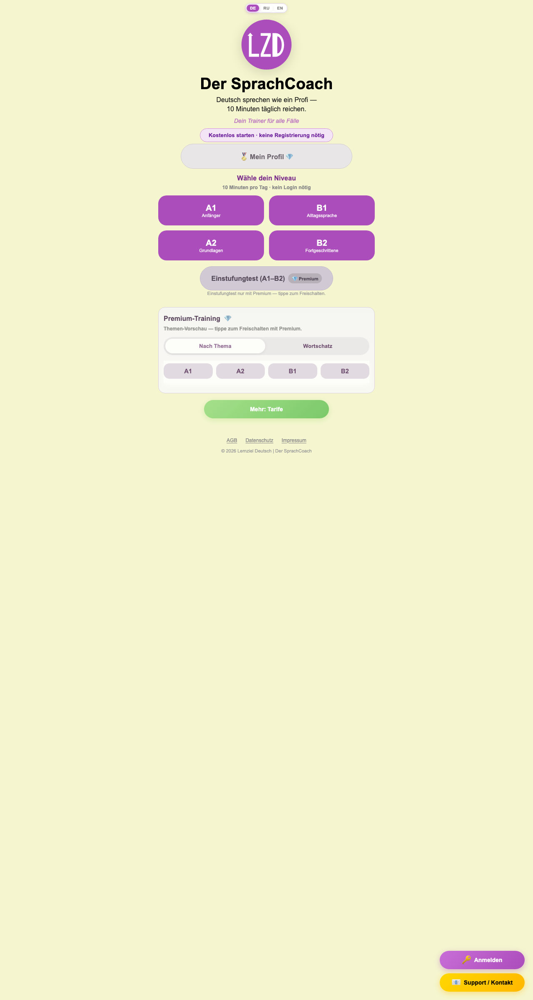
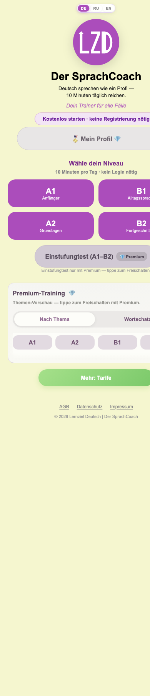

# 01 — Landing page (`/`) + App shell

Source: `src/site/views/Landing.vue`, `src/site/App.vue`, `src/site/components/BootstrapHandler.vue` and the child components listed below.

---

## 1. Route & access

| Item | Value |
|---|---|
| Path | `/` (hash router: `#/`), route name `landing` — `src/site/router/index.js:26` |
| Fallback | Any unknown path redirects to `landing` — `src/site/router/index.js:36` |
| Guards | None on `landing` itself. Global `beforeEach` (`src/site/router/index.js:43-59`) only affects `premium` (Premium users are redirected **to** landing unless `?focus=basis`) and `trainer` (Premium-only trainer queries redirect free users to `/premium?hub=1`, only once `entitlementsReady` and a backend exists). |
| Scroll | Every navigation scrolls to top — `src/site/router/index.js:38-40` |
| Access | Public. Same layout for free, Basis and Premium; Premium only unlocks features in place (`src/site/views/Landing.vue:2-6`). |
| Bootstrap query params | Read from `window.location.search` (i.e. **before** the `#`) by `BootstrapHandler` on app mount, on any route: `?stripe_success=1`, `?activate=<CODE>`, `?mltoken=<TOKEN>` — see §5.3. |

**Backend vs. no-backend.** `hasBackend()` is `true` when `SCRIPT_URL` is non-empty (`src/site/utils/api.js:32-34`). `SCRIPT_URL` is hard-coded to a Google Apps Script URL (`src/site/data/payment.js:32-33`), so production always runs with a backend. Demo mode (empty `SCRIPT_URL`) only grants entitlements in `import.meta.env.DEV` builds (`src/site/composables/usePremium.js:602-616`).

**Entitlement flags** (`src/site/composables/usePremium.js:602-618`):
- `isPremium` / `isBasis` are `false` until `entitlements.ready` when a backend exists.
- `isLoggedIn` = magic-link session with `email`, `sessionToken` and a `sessionExpires` that has not passed (`src/site/composables/useAuth.js:34-37`).

## 2. Purpose

The home page and main entry point. It:
- introduces the product (logo, title, slogan),
- lets anyone start free training at level A1/A2/B1/B2 with no login,
- shows Premium features (placement test, topic and vocabulary training hub, weak-spot mode, profile) as locked previews that open a checkout bottom sheet,
- acts as the dashboard (streak, XP, daily goal, bonus missions, activity calendar) for returning or Premium users.

## 3. Layout (top to bottom)

App shell (`src/site/App.vue:39-93`), rendered on every route:
0. `BootstrapHandler` overlays: Stripe success banner, “Anmeldung läuft…” overlay, toast (fixed position, only when triggered).
0. Bootstrap overlay “🔒 Zugriff wird geprüft…” (full-screen, only while `hasBackend() && !entitlementsReady`).
0. Backend-degraded banner “⚠️ …” (only when `backendDegraded.active`).
1. **LocaleSwitcher** pill DE / RU / EN, top centre.

Landing content (`src/site/views/Landing.vue:105-232`):

2. **Hero** (`header.landing-hero`)
   1. LZD logo, 260 px (`LzdLogo`)
   2. H1 title
   3. Subtitle, split onto two lines at ` — `
   4. Slogan (italic, purple)
   5. “Kostenlos starten…” badge *(free only)*
   6. Summary line 🔥 streak · ⭐ XP · Lv *(progress users only)*
   7. “🏅 Mein Profil” button (💎 suffix when locked)
   8. `DailyGoalCard` *(progress users only)*
3. **Levels section** (`section.landing-section--levels`, aria-label “Starten und Tarife”)
   1. H2 “Wähle dein Niveau” + hint *(non-Premium only)*
   2. 2×2 grid of level cards, in DOM order **A1, B1, A2, B2** (`src/site/views/Landing.vue:153-186`)
   3. `NiveauTestBlock` (placement test button + hint)
   4. `TrainingHubPanel` (“Premium-Training”)
   5. “Mehr: Tarife” button *(non-Premium only)*
4. **Dashboard section** *(progress users only)*: divider “Dein Fortschritt”, then `BonusMissionsCard` (only once the daily goal is met), `ActivityCalendar`, `SchwaechenCard`.
5. **LegalFooter**: AGB · Datenschutz · Impressum, then © line.
6. `ConversionSheet` (teleported bottom sheet, hidden by default).

Shell floating action buttons, fixed at bottom right (`src/site/App.vue:68-89`):
- “🔑 Anmelden” *(conditional, see §5)*
- “📧 Support / Kontakt” *(always)*

Modals (shell): `LoginModal`, `ContactModal`.

“Progress users” means `showProgressSection` = `isPremium || isLoggedIn || currentStreak > 0 || totalXP > 0` (`src/site/views/Landing.vue:54-60`).

## 4. Elements & behavior

### 4.1 Hero

| Element | Content (DE · i18n key) | Interaction / result |
|---|---|---|
| Logo (`src/site/components/LzdLogo.vue:27-56`) | SVG “LZD”, title/aria “Zur Startseite” (hard-coded) | Click / Enter / Space → `router.push('/')`, which does nothing visible on landing |
| Title | “Der SprachCoach” · `landing.title` | — |
| Subtitle | “Deutsch sprechen wie ein Profi — / 10 Minuten täglich reichen.” · `landing.subtitle` (10 = `FREE_MINUTES_PER_DAY`, `src/site/composables/useFreeDailyLimit.js:11`) | Text is split on `' — '` with a forced ` ` (`src/site/views/Landing.vue:69,110-112`) |
| Slogan | “Dein Trainer für alle Fälle” · `landing.slogan` | — |
| Free badge | “Kostenlos starten · keine Registrierung nötig” · `landing.freeStart` | Shown when `!isPremium && !isBasis` (`:65-67`) |
| Summary | `🔥 <n> Tag/Tage` (only if streak > 0; `common.day`/`common.days`) · `⭐ <n> XP` · `Lv<n> <name>` (level names hard-coded German in `src/site/composables/useXp.js:82-86`: Anfänger, Lernender, Fortgeschrittener, Profi, Meister) | Rendered with `v-html` (`:117-121`). Shown only to progress users. |
| Mein Profil | “🏅 Mein Profil” · `landing.profileBtn`; adds 💎 and `--locked` style when `!isPremium` | `onProfileClick` (`:96-102`): if not Premium **and** not logged in → opens ConversionSheet variant `checkout`; otherwise → `/profile` (a logged-in free user also goes to `/profile`) |
| DailyGoalCard (`src/site/components/DailyGoalCard.vue`) | Title “🎯 Heutiges Ziel” / “✅ Tagesziel geschafft!” (`dailyGoal.title`/`titleDone`); “{today} / {goal} Fragen” (`dailyGoal.count`, goal = 20, `src/site/composables/useDailyGoal.js:13`); progress bar; hint `dailyGoal.hintOne`/`hintMany`/`hintDone` | Click / Enter / Space → opens `DailyGoalDetailModal` (teleported to body; sections Heutiges Ziel, Dein Niveau (Premium), Dein Fortschritt, XP im Training, Tages-Meilensteine; strings hard-coded) |

### 4.2 Levels section

| Element | Content | Interaction / result |
|---|---|---|
| Heading | “Wähle dein Niveau” · `landing.levelPickTitle` | — |
| Hint | “10 Minuten pro Tag · kein Login nötig” · `landing.startA1Hint` | Shown when `!isPremium` |
| Level card A1 | “A1” / “Anfänger” · `landing.levelA1` | → `/trainer?level=A1&mode=free` (`:71-73`) |
| Level card B1 | “B1” / “Alltagssprache” · `landing.levelB1` | → `/trainer?level=B1&mode=free` |
| Level card A2 | “A2” / “Grundlagen” · `landing.levelA2` | → `/trainer?level=A2&mode=free` |
| Level card B2 | “B2” / “Fortgeschrittene” · `landing.levelB2` | → `/trainer?level=B2&mode=free` |
| Placement test button (`src/site/components/NiveauTestBlock.vue`) | “Einstufungtest (A1–B2)” · `landing.niveauTest`; when a CEFR level is stored: “Einstufungtest · {level} (A1–B2)” · `landing.niveauRetest`. Badge “💎 Premium” · `common.premium` *(non-Premium)* | Premium → `/trainer?mode=placement`. Otherwise emits `locked` → Landing opens ConversionSheet variant `niveau` (`src/site/views/Landing.vue:84-86`) |
| Placement test hint | Premium: “60 zufällige Fragen aus dem Trainer (15 pro Niveau, steigend A1→B2).” · `landing.niveauHintPremium`; otherwise: “Einstufungtest nur mit Premium — tippe zum Freischalten.” · `landing.niveauHintLocked` | — |
| “Mehr: Tarife” | `landing.moreBtn` | Shown when `!isPremium`. → `/premium?hub=1` (`:75-77`) |

### 4.3 TrainingHubPanel (`src/site/components/TrainingHubPanel.vue`), props `locked = !isPremium`, `initial-level = cefrLevel || 'A1'`

| Element | Content | Interaction / result |
|---|---|---|
| Title | “Premium-Training” · `premium.trainingAria`, plus 💎 when locked | — |
| Locked hint | “Themen-Vorschau — tippe zum Freischalten mit Premium.” · `premium.hubTopicsHint` | Shown only when locked |
| Mode switch (tablist) | “Nach Thema” · `premium.modeTopics` / “Wortschatz” · `premium.modeVocab` | Switches the list. Default is `topics` (`:37`). |
| Level tabs (tablist, aria “Niveau wählen” · `premium.chooseLevel`) | A1, A2, B1, B2 | **Locked:** no tab is selected and the list is collapsed at first. A tap opens that level's list; tapping the active tab again collapses it (`:98-108`). **Unlocked:** pre-selects `initialLevel` → stored CEFR level → A1; the list is always open (`:43-61`). |
| Topic button | Topic name, “{count} Fragen” · `premium.questionsCount`, description; ✅ if mastered (≥ 50 correct, Premium only); 💎 when locked | Locked or not Premium → emits `unlock` → ConversionSheet `checkout`. Premium → `/trainer?level=<L>&topic=<key>&mode=premium` (`:112-124`) |
| Vocab set button | Set name, question count, description; accent colour from `set.theme.accent` | Locked → `unlock`. Premium → `/trainer?level=<L>&set=<key>&mode=vocab` (`:126-138`) |
| Vocab empty | “Für {level} gibt es noch keine Wortschatz-Sets.” · `premium.vocabEmpty` | — |

### 4.4 Dashboard section (progress users only)

| Element | Content | Interaction / result |
|---|---|---|
| Divider | “Dein Fortschritt” · `landing.sectionDashboard` | — |
| BonusMissionsCard (`src/site/components/BonusMissionsCard.vue`) | Rendered only when the daily goal is met (`:36`). Hard-coded DE: “🏅 Bonus-Aufgaben für heute”, “{done} / {n} erledigt”, an intro line, then 3 missions from `useDailyBonus` (⚡ 5 Bonus-Fragen, 📚 level mission, 🎯 Perfekte Serie or 🔧 Schwäche: <topic> [Premium]), each with a progress bar, “+N XP”, and status “✅ Belohnt” / “🎁 Wird im Training gutgeschrieben”; tier row “📈 Tages-Meilensteine” (25/30/35 Fr. +5/+8/+12 XP) | Mission CTA “▶ {ctaLabel}” → `router.push(m.cta)` (e.g. `/trainer?level=X&mode=premium`). Premium-flagged missions are hidden for non-Premium users (`:18-20`). Claimed missions have no CTA. |
| ActivityCalendar (`src/site/components/ActivityCalendar.vue`) | `
` element. Summary: “📅 Aktivitätenkalender”, “{active} / 42 Tage” · `calendar.count`, bar, hint `calendar.hintEmpty`/`hintActive`. Body: weekday header `calendar.dayLabels`, 6×7 grid of the last 42 days (cell title = ISO date), legend “weniger / aktiv / heute” | Click the summary to expand or collapse (native `
`). Collapsed by default. |
| SchwaechenCard (`src/site/components/SchwaechenCard.vue`) | `
`. Title “🎯 Schwächen-Modus” · `schwaechen.title`. Count: non-Premium “💎 Premium” · `countPremium`; no errors “0 / 3 Themen” · `countEmpty`; otherwise “{errors} Fehler · {topics} Themen” · `countSummary`. Bar = errors/30 (capped at 100 %). Hint `hintLocked`/`hintEmpty`/`hintReady`. | Expanded body: **non-Premium** → `bodyLocked` + “💎 Premium freischalten” (`unlock`) → emits `locked` → ConversionSheet `checkout`. **Premium without errors** → `bodyNoErrors` + “Zu den Premium-Themen →” (`toTopics`) → `router.push({name:'landing'})`, which does nothing (same page). **Premium with errors** → `listTitle`, a list “{level} · {topic} — {n} Fehler” for the top 3, and “▶ Schwächen trainieren” → `/trainer?mode=schwaechen` |

### 4.5 ConversionSheet (`src/site/components/ConversionSheet.vue`), used with `plan="3months"`

Landing uses only the `niveau` and `checkout` variants. Both go straight to the checkout form (`:55-56`).

| Element | Content | Interaction / result |
|---|---|---|
| Backdrop | — | Click → `later` + close |
| × close | aria “Später” · `funnel.later` | Close |
| Title | `niveau`: “Einstufungtest?” · `funnel.niveauTitle`; `checkout`: “Premium freischalten” · `funnel.checkoutTitle` | — |
| Body (`niveau` only) | “Der Einstufungtest (A1–B2) ist Premium — ab 19€/Monat freischalten.” · `funnel.niveauBody` | — |
| Plan radios | “Wähle deinen Plan:” · `premium.choosePlan`; “12 Monate – 99€ (3 Monate gratis)”, “3 Monate – 49€ (1 Monat gratis) −17%”, “1 Monat – 19€” (`premium.plan12/plan3/plan1`, `common.monthsFree3/monthFree1`, `funnel.discountBadge`) | Default selection `3months`. The selection resets on every open. |
| Hint | `funnel.checkoutHint` | — |
| E-mail | Label `premium.emailLabel`, placeholder “deine@email.de” · `common.emailPlaceholder`; prefilled from localStorage `userEmail` | — |
| AGB checkbox | “Ich stimme den [AGB] zu und bestätige, …” · `common.agbAcceptBefore` + link + `common.agbAcceptAfter` | The link goes to `/legal/agb` |
| Stripe button | “Bezahlen” / “Visa, Mastercard, Apple Pay, Google Pay” · `premium.payStripe`/`stripeSub` | Validation: e-mail must contain `@` (else `premium.errEmailForCode`) and the AGB box must be checked (else `premium.errAgb`). On success: saves `userEmail` and opens `STRIPE_LINKS[plan]?prefilled_email=…` in a new tab. Status `premium.stripeOpened`. |
| PayPal button | “Kaufen” / “Code kommt automatisch per Mail” | Same validation → opens `paypal.me/<handle>/<amount>` (`src/site/data/payment.js:131-134`). Status `premium.paypalOpened`. |
| Basis button | “⏱️ Nur Zeitlimit aufheben – {price}€” · `funnel.basisQuick` | Same validation → opens the Stripe Basis link. Status `premium.basisStripeOpened`. |
| “Alle Pläne anzeigen →” | `funnel.allPlans` | Closes → `/premium?hub=1&plan=<selected>` |
| “Später” | `funnel.later` | Close |

### 4.6 App shell

| Element | Content | Interaction / result |
|---|---|---|
| LocaleSwitcher (`src/site/components/LocaleSwitcher.vue`) | Buttons DE / RU / EN (titles Deutsch / Русский / English), group aria `common.localeSwitcherAria`; `aria-pressed` on the active button | `setLocale(code)` → updates UI strings reactively, writes localStorage `uiLocale` and sets `<html lang>` (`src/site/i18n/index.js:61-70`). Default `de`. |
| Login FAB | “🔑 Anmelden” · `login.fabLabel` | Visible when (`src/site/App.vue:31-36`): backend exists **and** not logged in **and** route is not `trainer` **and** (on `landing`: `!isBasis`; on `premium`: only with `?hub=1`). Click → `LoginModal`. |
| Support FAB | “📧 Support / Kontakt” · `common.support`, aria `common.openContact` | Always visible. Click → `ContactModal`. |
| LoginModal (`src/site/components/LoginModal.vue`) | Title “Anmelden per E-Mail” · `landing.sectionLoginOnly`, intro “Kein Passwort — Link in dein Postfach.” · `landing.sectionLoginOnlyHint`, then `LoginPanel prominent` | × (aria `contact.close`) or a backdrop click closes it |
| LoginPanel (`src/site/components/LoginPanel.vue`), not logged in | 3-step visual 📧 E-Mail → 📬 Brief → ✅ Fertig; optional “Willkommen zurück!” + “Login-Link an {email} senden” when the field equals the stored `userEmail`; label `common.emailLoginPlaceholder`, input placeholder `name@beispiel.de`; button “📧 Link an meine E-Mail” · `login.sendLink` (“…” while sending) | Validates `@` (`login.errInvalidEmail`), saves `userEmail`, calls `requestMagicLink` → success view “✉️ {linkSent / linkSentDelayed}” with a resend button `login.sendLinkShort`; error “✖ {error / login.errGeneric}” |
| LoginPanel, logged in and Premium/Basis | “👤 {email}” + “Abmelden” · `common.signOut`, note `login.loggedInPremium` | Sign out → `signOutUser()` + page reload |
| LoginPanel, logged in and free | Session row, “🔑 Hast du einen Code? Hier eingeben:” · `login.codePrompt`, input `login.codePlaceholder`, “Aktivieren” · `common.activate`, aside with a link to `/premium` | `activateCode` → `login.premiumActivated` / `login.basisActivated` and reload after 1.5 s; error “✖ …” |
| ContactModal (`src/site/components/ContactModal.vue`) | Title “📧 Kontakt” · `contact.title`; inputs `contact.name`, `contact.email` (prefilled from `userEmail`), textarea `contact.message`; button “Nachricht senden” · `contact.submit` / “Wird gesendet…”; footer `contact.responseTime` | An empty message → `contact.errEmptyMessage`. Otherwise `sendContactForm` → `contact.sentOk` and auto-close after 1.5 s; error “✖ {error / contact.errSend}”. No backend: DEV → `contact.sentDemo` and close; PROD → `contact.errBackend`. × or backdrop closes. |

## 5. States & variants

### 5.1 Entitlement / user matrix

| State | Free badge | Summary + DailyGoal + Dashboard | Profile btn | Level hint | Niveau | Hub | “Mehr: Tarife” | Login FAB |
|---|---|---|---|---|---|---|---|---|
| New anonymous (0 XP, no streak) — screenshot | ✔ | ✘ | 💎 → sheet | ✔ | locked → sheet `niveau` | locked, collapsed | ✔ | ✔ |
| Anonymous with XP/streak > 0 | ✔ | ✔ | 💎 → sheet | ✔ | locked | locked | ✔ | ✔ |
| Logged-in free | ✔ | ✔ | 💎 but → `/profile` | ✔ | locked | locked | ✔ | ✘ |
| Basis (`isBasis`, not Premium) | ✘ | depends on progress | 💎 (→ sheet if not logged in) | ✔ | locked | locked | ✔ | ✘ on landing |
| Premium, not logged in | ✘ | ✔ | → `/profile` | ✘ | active → placement trainer | unlocked, list open | ✘ | ✔ |
| Premium, logged in | ✘ | ✔ | → `/profile` | ✘ | active | unlocked | ✘ | ✘ |

### 5.2 Loading / bootstrap
- While `hasBackend() && !entitlementsReady`, a full-screen overlay “🔒 Zugriff wird geprüft…” (`common.checkingAccess`, `role=status`) covers the app (`src/site/App.vue:25,42-52`). The overlay ends after at most 4 s (`BOOTSTRAP_UI_MS`, `src/site/composables/usePremium.js:481-505`). On timeout the cached grace snapshot is applied and the refresh keeps running in the background.
- Until ready, `isPremium`/`isBasis` are `false`, so the page renders as free under the overlay.

### 5.3 Bootstrap query params (`src/site/components/BootstrapHandler.vue:212-219`, executed in order on mount)

| Param | Behavior |
|---|---|
| `?stripe_success=1` | Strips the param. Shows a fixed green banner “✅ Zahlung erfolgreich! Prüfe deine E-Mail — dein Aktivierungscode wurde zugesendet.” with a ✕ close button. After 2 s → `router.push({name:'landing'})` (`:93-99`). |
| `?activate=<CODE>` | Strips the param. Stores the upper-cased code in sessionStorage `pendingActivationCode` → `/premium?hub=1` (`:105-116`). |
| `?mltoken=<TOKEN>` | Strips the param. No backend → error toast “⚠ Magic-Link benötigt eine Backend-Konfiguration.” Otherwise: overlay “🔑 Anmeldung läuft…” while `validateMagicToken` runs. On failure: red toast (`login.errDeviceLimit` for `DEVICE_LIMIT`, else server error or “Link ungültig”) for 6 s. On success: `setSession`, merge server progress, apply entitlements. Then: if a pending code exists → `activateCode`; success → toast “✅ Willkommen & Code aktiviert!” + reload after 1.5 s; failure → toast “Willkommen! Code-Fehler: …”. Otherwise it activates any `premiumCode`/`basisCode` linked to the account and toasts “✅ Willkommen, {email}! Premium ist aktiv.” / “Basis ist aktiv.” / plain welcome (`:124-197`). |
| (always) | `bootstrapEntitlements()` → `pullProgressFromServer()` (only when logged in) → if logged in and Premium or Basis, and not already on landing → `router.replace` to landing (`:199-210`). |

Toasts appear bottom-centre, green `#2e7d32` or red `#c62828`, for 4 s by default (`:79-88`).

### 5.4 Errors / degraded
- Transient backend failure with a grace snapshot → an amber banner at the top: “⚠️ Server vorübergehend nicht erreichbar — dein Zugang bleibt vorerst aktiv.” (or an OAuth variant, set in `src/site/composables/usePremium.js:100-102`; fallback `common.backendDegraded`).
- A definitively invalid magic session → logout. An invalid code → stored codes are cleared (`src/site/composables/usePremium.js:409-448`).

### 5.5 No-backend demo mode (`SCRIPT_URL = ''`)
- No bootstrap overlay, no Login FAB, and `LoginPanel` renders nothing (`v-if="backendOn"`).
- In DEV, entitlements come from stored code prefixes `PREMIUM*` / `BASIS*` (`src/site/composables/usePremium.js:255-290`). In PROD everything stays free.

### 5.6 Mobile
- The level grid stays 2×2. The `.app-shell--landing` max width is 980 px with 20 px side padding (`src/site/styles/main.css:84-88`). Breakpoints are at 480/600/700/768 px.
- See §9 for the clipping visible in `landing-mobile.png`.

## 6. Data & persistence

| Composable | Used for | Storage |
|---|---|---|
| `useAuth` | `isLoggedIn`, session | localStorage `lzd_user_v1` `{email, sessionToken, sessionExpires}` |
| `usePremium` | `isPremium`, `isBasis`, `entitlementsReady`, `backendDegraded` | localStorage `lzd_premium` (codes only), `lzd_entitlement_grace` (grace snapshot); sessionStorage `lzd_premium_session_token`, `lzd_premium_session_expires`. Entitlements are held in memory only. |
| `useStreak` | `currentStreak`, `activeDays` | localStorage `lzd_streak` |
| `useXp` | `totalXP`, level, topic counters | localStorage `lzd_xp`, `lzd_topic_correct`, `lzd_topic_wrong` |
| `useCefrLevel` | Stored placement level | localStorage `lzd_cefr_level` |
| `useDailyGoal` | Today's count and goal (20) | localStorage `lzd_daily_goal` `{date, count}` |
| `useDailyBonus` | Missions and tiers | localStorage `lzd_daily_bonus` |
| `useLoginModal` | Shared `showLogin` ref | memory |
| i18n | Locale | localStorage `uiLocale` |
| Login / Contact / Sheet | Remember e-mail | localStorage `userEmail` (removed on sign-out) |
| BootstrapHandler | Pending code | sessionStorage `pendingActivationCode` |
| API client | Device ID | `deviceId` (localStorage, then cookie, then sessionStorage — `src/site/utils/deviceId.js`) |

API calls (Google Apps Script, `src/site/utils/api.js`) triggered from this page and shell: `validateMagicToken` (`:238`), `refreshMagicSession` (`:288`), `validateCode` (`:218`), `loadProgressByEmail` (`:339`), `requestMagicLink` (`:257`), `revokeMagicSession` (`:304`), contact form POST `{contactForm:true,…}` (`:321`). Progress pushes (`saveProgressByEmail`, `saveStreakByCode`) are debounced by 800 ms after local changes (`src/site/composables/useProgressSync.js:76-108`). All calls are normalised to `{ok:false,error}` on failure and never throw.

External navigation: Stripe Payment Links and paypal.me open in a new tab (`noopener`).

## 7. Navigation

| From Landing to | Trigger |
|---|---|
| `/trainer?level=X&mode=free` | Level cards |
| `/trainer?mode=placement` | Placement test (Premium) |
| `/trainer?level=X&topic=K&mode=premium` / `&set=K&mode=vocab` | Hub items (Premium) |
| `/trainer?mode=schwaechen` | SchwaechenCard “Schwächen trainieren” (Premium with errors) |
| `/trainer?...` (mission `cta`) | BonusMissionsCard CTA |
| `/profile` | Mein Profil (Premium or logged in) |
| `/premium?hub=1` | “Mehr: Tarife” |
| `/premium?hub=1&plan=P` | ConversionSheet “Alle Pläne anzeigen →” |
| `/legal/agb`, `/legal/datenschutz`, `/legal/impressum` | LegalFooter, ConversionSheet AGB link |
| `/premium` | LoginPanel aside link |

| Into Landing from | Mechanism |
|---|---|
| Any unknown path | Router catch-all redirect |
| `/premium` while Premium (no `focus=basis`) | Router guard |
| Logo on any page | `LzdLogo` |
| `?stripe_success=1` | BootstrapHandler, after 2 s |
| Magic-link login for Premium/Basis | BootstrapHandler `finishPostLoginNavigation` |
| Legal page “← Zurück” | `Legal.vue` |

## 8. Acceptance criteria

1. Opening `#/` as a new visitor (empty storage) shows: locale switcher, logo, title “Der SprachCoach”, the two-line subtitle, slogan, free badge, “🏅 Mein Profil 💎”, “Wähle dein Niveau” with hint, four level cards, a locked placement-test button with the “💎 Premium” badge, a locked “Premium-Training 💎” panel with no level tab selected and no list, “Mehr: Tarife”, and the legal footer. No summary line, no daily goal and no “Dein Fortschritt” section.
2. Clicking card A1/A2/B1/B2 navigates to `#/trainer?level=<L>&mode=free` for every user type.
3. For a non-Premium user, clicking the placement test opens the bottom sheet titled “Einstufungtest?”, with plan “3 Monate – 49€” preselected.
4. For a non-Premium user, clicking a hub level tab expands that level's topic list with 💎 on every item. Clicking the same tab again collapses it. Clicking any topic or vocab item opens the sheet titled “Premium freischalten”.
5. For a new anonymous user, clicking “Mein Profil” opens the “Premium freischalten” sheet. For a logged-in free user it navigates to `#/profile`.
6. In the sheet, Stripe/PayPal/Basis with an e-mail lacking `@` shows “✖ Bitte deine E-Mail für den Code eingeben.”. With a valid e-mail but the AGB box unchecked it shows “✖ Bitte stimmen Sie den AGB zu.”. With both valid it opens the provider URL in a new tab and stores `userEmail`.
7. Clicking the backdrop, ×, or “Später” closes the sheet. Reopening it resets the plan to 3 months and clears the status text.
8. “Mehr: Tarife” navigates to `#/premium?hub=1` and is hidden for Premium users.
9. Once a user has `totalXP > 0` or `currentStreak > 0` (or is logged in or Premium), the summary line, DailyGoalCard and the “Dein Fortschritt” section (calendar, Schwächen card) are visible. Bonus missions appear only after 20 questions today.
10. For a Premium user, the free badge, level hint and “Mehr: Tarife” are hidden; the hub is unlocked with the stored CEFR level (or A1) preselected and its list open; the placement test navigates to `#/trainer?mode=placement`.
11. The Support FAB is visible on Landing for every user and opens the Kontakt modal. Sending an empty message shows “Bitte gib eine Nachricht ein.”.
12. The Anmelden FAB is visible on Landing when a backend exists, the user is not logged in, and the user is not Basis-only. It opens a modal titled “Anmelden per E-Mail”.
13. Selecting RU or EN in the locale switcher re-renders all i18n strings immediately and persists `uiLocale`. After a reload the choice is kept.
14. While entitlements are being checked, the overlay “Zugriff wird geprüft…” is shown for at most about 4 s.
15. Loading `/?stripe_success=1#/` shows the green success banner, removes the param from the URL, and lands on `#/` after 2 s.
16. Loading `/?activate=abc#/` stores `ABC` in sessionStorage `pendingActivationCode` and navigates to `#/premium?hub=1`.
17. Loading `/?mltoken=<valid>#/` shows “Anmeldung läuft…”, then a welcome toast, and stores `lzd_user_v1`. An invalid token shows a red toast for 6 s.
18. At 390 px width no content is clipped and there is no horizontal scrolling (see §9).

## 9. Open questions / observations

1. **Mobile clipping.** `landing-mobile.png` shows the right edge cut off (B1/B2 cards, the free badge, the hub B2 tab), and no FABs are visible. `html`/`body` use `overflow-x: hidden` (`src/site/styles/main.css:12-25`), so any overflow is clipped silently rather than scrollable. This may be a screenshot-viewport artifact or a real layout bug; it needs verifying on a device.
2. **Bonus mission CTAs for free users** always use `mode: 'premium'` (`src/site/composables/useDailyBonus.js:98,113,126`). For a free user the router guard (`src/site/router/index.js:52-55`, `trainerRequiresPremium`) redirects them to `/premium?hub=1` instead of training.
3. **Dead branch:** `BonusMissionsCard` filters out Premium missions for non-Premium users (`:18-20`), so the “💎 Premium” CTA (`:88`) and `startMission` premium redirect (`:23-25`) are unreachable.
4. **SchwaechenCard “Zu den Premium-Themen →”** pushes `landing` while already on landing (`src/site/components/SchwaechenCard.vue:60-62`), so it does nothing (no scroll to the hub).
5. **Profile button logic:** a logged-in free user sees the 💎 “locked” style but is sent to `/profile` (`src/site/views/Landing.vue:63,96-102`). A Basis user who is not logged in gets the Premium checkout sheet.
6. **Level card DOM order is A1, B1, A2, B2** (`src/site/views/Landing.vue:153-186`), which is unusual for keyboard and screen-reader order. Visually it is A1/B1 on top, A2/B2 below.
7. **Premium users start level cards in `mode=free`** (`src/site/views/Landing.vue:72`). Whether the trainer still applies Premium benefits needs checking in the trainer spec.
8. **Typo:** “Einstufungtest” (should be “Einstufungstest”) in `landing.niveauTest`, `niveauRetest`, `niveauHintLocked`, `funnel.niveauTitle`/`niveauBody` and `trainer.placementShareText`.
9. **Comment and code disagree:** the BootstrapHandler header says `stripe_success` navigates to `/premium` (`:12-13`), but the code goes to `landing` (`:98`).
10. **Non-i18n strings:** BootstrapHandler toasts and banners, BonusMissionsCard, DailyGoalDetailModal, the LzdLogo title, `useXp` level names, and the LoginPanel placeholder `name@beispiel.de` are hard-coded German. They will not switch with RU/EN.
11. **Summary uses `v-html`** (`src/site/views/Landing.vue:117-121`). The content is currently internal (numbers plus i18n strings), but a malicious RU/EN translation string would be injected unescaped.
12. **Bootstrap params must precede `#`** (`src/site/data/payment.js:42-46`). A link like `#/?mltoken=…` is silently ignored.
13. **ConversionSheet “3 Monate −17%” badge** versus the plan note “(1 Monat gratis)”: 49 € vs 3×19 € = 57 € is about −14 %, not −17 %. The pricing copy needs verifying.
14. **The Anmelden FAB is hidden for Basis users on landing** (`src/site/App.vue:34`), but shown for Premium users who are not logged in. The rationale is undocumented: a Basis user cannot reach the login modal from landing.
15. **The `TrainingHubPanel` mode switch works while locked**, and an empty vocab level shows the “noch keine Wortschatz-Sets” text even in the teaser.
