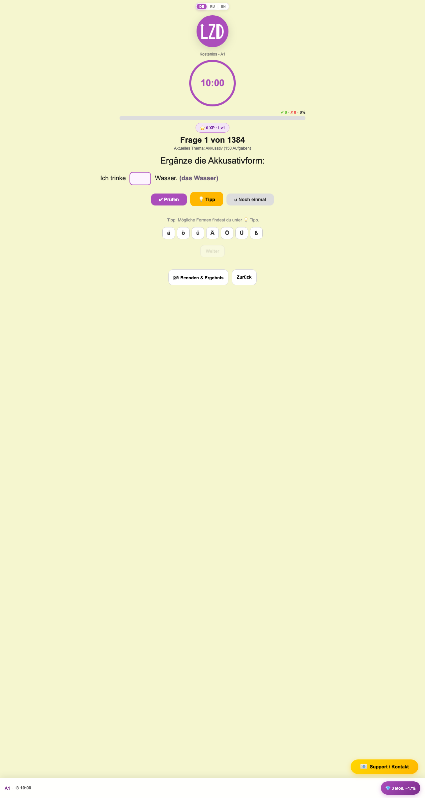
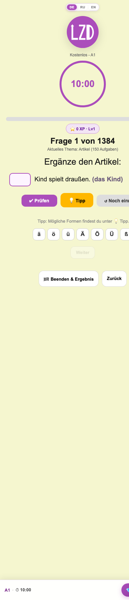
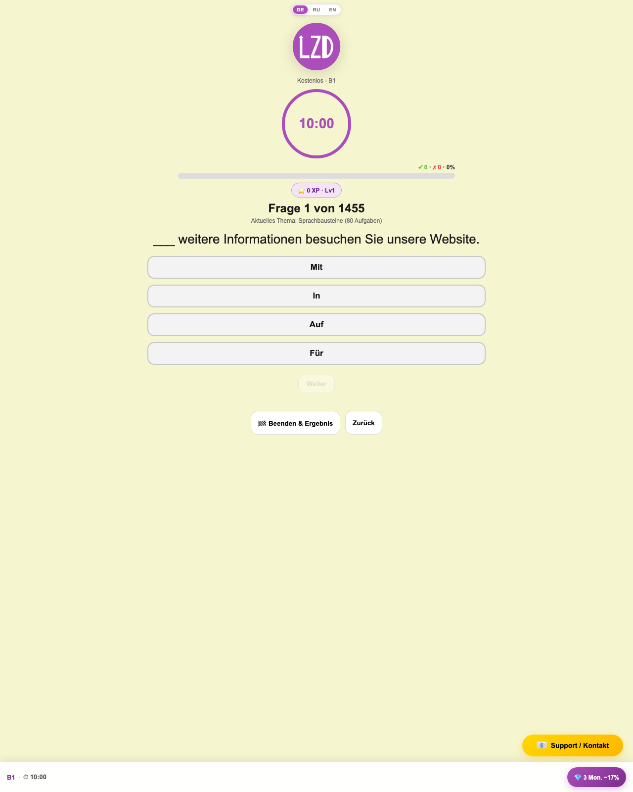
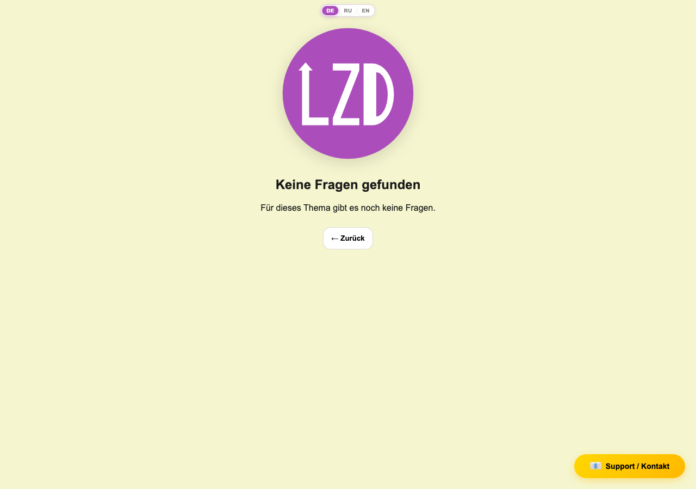
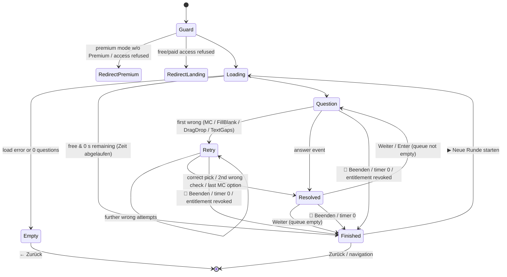

# 02 — Trainer (`/trainer`)

Source: `src/site/views/Trainer.vue` (1516 lines) and everything it renders:
`src/site/components/questions/*`, `GrammarTip.vue`, `DictionaryPopup.vue`,
`PrepositionSpatialHint.vue`, `ConversionSheet.vue`, plus composables/utilities
listed per section. All references are `path:line` against the current `main`
(commit `193ba144`).

---

## 1. Route & access

### 1.1 Route

| Item | Value |
|---|---|
| Path / name | `/#/trainer`, name `trainer` (`src/site/router/index.js:27`) — hash history (`src/site/router/index.js:24`) |
| Component | `src/site/views/Trainer.vue` |
| Scroll | Always scrolls to top on navigation (`src/site/router/index.js:38-40`) |

### 1.2 Query parameters

| Param | Values | Default | Read at | Effect |
|---|---|---|---|---|
| `level` | `A1`, `A2`, `B1`, `B2` (any string accepted) | `A1` | `Trainer.vue:82`, reset `:453` | CEFR level of the question pool. Unknown values (e.g. `C1`) yield an empty pool → "Keine Fragen gefunden" (see §7). |
| `topic` | Topic folder key, e.g. `AKKUSATIVA1`, `PASSIVB2` | `''` | `Trainer.vue:83`, `:454` | Restricts pool to one topic. Matching is case-insensitive and strips a trailing CEFR suffix, so `AKKUSATIV` matches `AKKUSATIVA1` (`src/site/data/questions.js:58-60,164-173`). Implies Premium. |
| `mode` | `free`, `premium`, `schwaechen`, `placement`, `vocab` (anything else behaves like a plain level session) | none | `Trainer.vue:84-86` | Selects the session mode (§2.2). |
| `set` | Vocab set key, e.g. `EINKAUFEN` | `''` | `Trainer.vue:87` | Wortschatz set (only with `mode=vocab`); upper-cased. |
| `returnTo` | `hub` | — | `Trainer.vue:825` | Only forwarded when starting a wrong-topic training from the result screen; never used to choose the exit target (see §11). |

Changing any of `mode|level|topic|set` while the view is mounted resets state and
re-initialises the session (`Trainer.vue:512-521`).

### 1.3 Who links here

| Origin | Query | Source |
|---|---|---|
| Landing level buttons | `{ level, mode: 'free' }` | `src/site/views/Landing.vue:71-73` |
| Training hub — topic grid | `{ level, topic, mode: 'premium', returnTo? }` | `src/site/components/TrainingHubPanel.vue:111-124` |
| Training hub — Wortschatz set | `{ level, set, mode: 'vocab', returnTo? }` | `src/site/components/TrainingHubPanel.vue:126-138` |
| Niveau-Test block | `{ mode: 'placement' }` | `src/site/components/NiveauTestBlock.vue:24` |
| Schwächen card | `{ mode: 'schwaechen' }` | `src/site/components/SchwaechenCard.vue:53` |
| Daily bonus missions | `{ level, mode: 'premium' }` / `{ level, topic, mode: 'premium' }` | `src/site/composables/useDailyBonus.js:98,113,126,146-149` |
| Trainer result screen | placement → `{ level, mode: 'premium' }`; wrong topic → `{ level, topic, mode: 'premium' }`; "Niveau testen" → `{ mode: 'placement' }` | `Trainer.vue:708-716,823-827` |

### 1.4 Access tiers

Entitlements come from `usePremium()` (`src/site/composables/usePremium.js:620-660`):

| Tier | `isPremium` | `isBasis` | Trainer capabilities |
|---|---|---|---|
| Free | false | false | Level-wide sessions only (`mode=free` or no mode). 10-minute daily countdown. ±1 XP. Upsell hints, sticky funnel bar, conversion sheets. |
| Basis (4,99 € one-off, `src/site/data/payment.js:97`) | false | true | Same content as Free, **no time limit** (count-up timer, hidden). ±1 XP. No funnel bar/sheets; still sees wrong-answer upsell hint (§12). |
| Premium | true | — | All modes; topic, vocab, Schwächen, Niveau-Test; ±2 XP; Grammatik-Tipp after errors; dictionary popup; wrong-topic "▶ Trainieren". |

"Premium-only" query (`trainerRequiresPremium`, `src/site/utils/premiumAccess.js:9-17`): `mode` ∈ {`schwaechen`, `placement`, `premium`, `vocab`} **or** non-empty `topic` **or** non-empty `set`.

Backend vs demo:
- `hasBackend()` is true iff `SCRIPT_URL` is non-empty (`src/site/utils/api.js:32-34`). It is currently set (`src/site/data/payment.js:31-32`), so production runs in backend mode.
- Without a backend, `isPremium`/`isBasis` are only ever true in a Vite DEV build (`usePremium.js:637-650`); in a production demo build every Premium route is refused.

### 1.5 Guards (in order)

1. **Global router guard** (`src/site/router/index.js:52-56`): with backend **and** `entitlementsReady`, a Premium-only query by a non-Premium user is redirected to `premium?hub=1`.
2. **`initTrainer()` mode guard** (`Trainer.vue:460-463`): `schwaechen`, `placement` or `vocab` without Premium → `router.replace({ name: 'premium', query: { hub: '1' } })`.
3. **`ensureAccessBeforeLoad()`** (`Trainer.vue:325-348`):
   - Free query and user not paid → allowed.
   - No backend: Premium query → refused; otherwise allowed iff paid.
   - Backend and entitlements already confirmed paid → allowed without a round-trip.
   - Otherwise `verifyEntitlementsLive()`; refused if not `ok`, if Premium needed but not Premium, or if the user was paid but is neither Premium nor Basis anymore.
   - On refusal (`Trainer.vue:466-477`): Premium-type sessions (`schwaechen|placement|vocab` or `topic`+`mode=premium`) → `premium?hub=1`; all others → `landing`.
4. **Entitlement polling** every 5 min during a session (`Trainer.vue:147,404-435`) when backend is present and the user is paid or the query is Premium. Degraded (network outage with grace) results are ignored. Revocation ends the session with reason `Session beendet` and redirects: not ok → `landing`; Premium lost on Premium query → `premium?hub=1`; paid lost → `landing`.

---

## 2. Purpose

The Trainer is the core exercise screen. It loads a pool of German grammar or
vocabulary questions for the chosen level/topic/mode, presents them one by one in
an adaptive queue (wrongly answered items return later), scores answers live,
awards XP, feeds the daily goal / streak / bonus missions, enforces the free
10-minute daily limit and finally shows a result screen with statistics, share
card, and follow-up actions. In `placement` mode it is a 60-question progressive
A1→B2 Einstufungstest that determines and stores the learner's CEFR level.

### 2.1 Mode overview

| Mode | Trigger | Pool | Shuffle | Header label | XP / goal | Notes |
|---|---|---|---|---|---|---|
| Free level | `mode=free` or no mode, no topic | All local questions of `level` (`getQuestionsByLevel`, `Trainer.vue:393`) | yes | `Kostenlos - {level}` / `Premium - {level}` (`trainer.free` / `trainer.premium`) | yes | Premium user on `mode=free` gets Premium label, ×2 XP and count-up timer. |
| Premium level | `mode=premium`, no topic | Backend `/api/questions?level=…` (`Trainer.vue:387-392`); local fallback if no backend | yes | `Premium - {level}` | yes | |
| Topic | `topic=…` (+ `mode=premium`) | Backend by level+topic, else local `getQuestionsByTopic` (`Trainer.vue:377-386`) | yes | `Premium - {level} / {topic}` | yes | Topic shown as raw key. |
| Wortschatz | `mode=vocab&set=…` | Local `src/site/questions-vocab/<LEVEL>/<SET>/*.md` via `getQuestionsByVocabSet` (`Trainer.vue:372-376`); never from backend | yes | `📚 Wortschatz · {level} / {set name}` (`trainer.vocabLabel`) | yes | Themed background (`--vocab-tint`, `--vocab-accent`, `--vocab-bg-image`, `Trainer.vue:97-109`). Missing `set` → empty pool. |
| Schwächen | `mode=schwaechen` | 3 weakest topics (`getWeakestTopics`, `src/site/utils/weakTopics.js:18-43`) → backend per topic or local (`Trainer.vue:361-371`) | yes | `🎯 Schwächen-Modus — {t1 · t2 · t3}` | yes | Empty if no wrong answers recorded → "Keine Fragen gefunden" + `schwaechen.bodyNoErrors`. `level` defaults to `A1` for bonus attribution. |
| Niveau-Test (placement) | `mode=placement` | 15 random questions per level A1–B2 in progressive order (`src/site/utils/placementTest.js:107-147`) | **no** (order preserved, `Trainer.vue:490`) | `Niveau-Test · 60 Fragen (A1→B2) — {q.level} · zählt nicht zum Tagesziel` | **no XP, no daily goal, no bonus** | Wrong answers are not re-queued. Result sets CEFR level. |

---

## 3. Layout

Reference screenshots (free user, desktop 1280 px and mobile):

Global chrome outside the view (language switch DE/RU/EN at top, "📧 Support / Kontakt" FAB) comes from `App.vue` and is specified elsewhere.

### 3.1 Active question screen (`Trainer.vue:1357-1509`), top to bottom

1. **Logo** `LzdLogo small` (`:1365`).
2. **Mode label** `.small-note` (`:1367-1391`) — see §2.1.
3. **Timer circle** `.timer-circle` `MM:SS` (`:1393`) — hidden for Basis users (`v-if="!isBasis"`). Free: countdown from remaining daily seconds; Premium: count-up from 00:00.
4. **Live score + progress** `.streak-box` (`:1395-1406`): `✓ {correct} · ✗ {wrong} · {pct}%` and a progress bar whose width = % of unique questions solved (`queue.progressPct`).
5. **Badges** (`:1408-1425`): `🔥 Tag {n}` (only if streak > 0), `⭐ {totalXP} XP · Lv{n}` (pulses 500 ms on each XP change), `💎 ×2 XP` (Premium only).
6. **Micro-feedback toast** (`:1427-1443`, `role="status"`, `aria-live="polite"`): lines such as `+2 XP`, `-1 XP`, `+1 Bonus-XP`, `🎁 +5 XP — 25 Fragen-Bonus`, `🎉 Lv2 — Lernender!`, `🏆 Thema gemeistert!`; auto-hides after 2.2 s (`:240-251`). Tone classes `micro-feedback--good|bad|celebrate`.
7. **Question heading** `Frage {current} von {total}` (`trainer.question`, `:1446-1448`). `current = min(solvedCount+1, total)`; `total` = unique questions after de-duplication.
8. **Topic pool hint** `Aktuelles Thema: {topic} ({count} Aufgaben)` (`trainer.topicPool`) — only in sessions without `topic` param (level-wide, Schwächen, placement, vocab) and when the question has a topic with a non-zero count in the grammar manifest (`:196-209`).
9. **Question widget** `QuestionRenderer` keyed by `question.id` (`:1453-1460`) — §5.
10. **Retry banner** `❌ Falsch! Versuche es noch einmal.` (`trainer.wrongRetry`) — while a first wrong attempt happened and the question is not yet resolved (`:1462-1464`).
11. **Grammatik-Tipp** box (Premium, after an error) (`:1466-1468`).
12. **Upsell hint** (non-Premium, after an error) — random one of 4 hard-coded HTML messages (`:675-683,1470`).
13. **Weiter** button `.next-btn` (`trainer.next`), disabled until the question is resolved (`:1472-1480`).
14. **Footer buttons**: `🏁 Beenden & Ergebnis` (`trainer.finish`) and `Zurück` (`trainer.backShort`) (`:1482-1487`).
15. **Dictionary popup** (Premium only) (`:1489-1493`).
16. **Sticky funnel bar** (free, non-Basis, active question, not placement/Schwächen) fixed to the bottom: `{level} · ⏱ {MM:SS}` and CTA `💎 3 Mon. −17%` (`funnel.stickyCta`) (`:1495-1508`). Sets `<html data-funnel-sticky="1">` so FABs move up (`:883-890`, `src/site/styles/main.css:1989`).
17. **ConversionSheet** bottom sheet (teleported to `<body>`) (`:1511-1515`).

### 3.2 Result screen (`Trainer.vue:1034-1354`)

Card (max-width 520 px):
- Emoji + headline: `⏱️ Gratis-Minuten aufgebraucht` (time expired) / `🎯 Dein Niveau: {lvl}` (placement) / `🏆 Ausgezeichnet!` (≥ 80 %) / `💪 Gut gemacht!` (≥ 60 %) / `📚 Weiter üben!` (< 60 %).
- Sub-line: free-limit message + funnel block (§3.3) **or** `Niveau-Test abgeschlossen` / `Session beendet`.
- Placement only: explanation "Bonus-Aufgaben und Trainingsempfehlungen werden ab jetzt an **{lvl}** angepasst." and per-level rows `A1  x/y (p%)` (`:1116-1132`).
- 4 stats: `{answered}` FRAGEN, `{correct}` RICHTIG, `{wrong}` FALSCH, `{pct}%` ERGEBNIS (`:1134-1157`).
- Chips: `🔥 Tag {streak}` (if > 0), `+{finalXp} XP ⭐` (if > 0), `Lv{n} {name}` (`:1159-1209`).
- Buttons (conditional, `:1211-1294`): `📤 Niveau teilen`, `📤 Ergebnis teilen`, `▶ {lvl} trainieren`, `▶ Neue Runde starten`, `← Zurück`, `Niveau testen (Premium)`.

Second card "📋 Themen mit Fehlern" (`:1297-1352`), sorted by error count desc; each row: level pill, topic name, `❌ {n} Fehler`, and (Premium) `▶ Trainieren`. Hidden for placement results.

### 3.3 Free-time-expired funnel block (`Trainer.vue:1085-1108`)

Lead `Morgen geht’s weiter — oder jetzt ohne Limit:` + `💎 Premium 3 Monate −17%` (opens ConversionSheet `checkout`) + `⏱️ Basis – 4.99€ einmalig` (→ `premium?focus=basis&hub=1`) + ghost `Morgen weiterüben` (→ landing).

---

## 4. Session flow

### 4.1 Lifecycle

1. **Mount** (`Trainer.vue:507-510`): `initTrainer()` and global `keydown` listener.
2. **Guards** (§1.5). Loading screen `Lade Fragen…` shows while `queue` is null and not finished (`:1008-1016`).
3. **Load pool** `loadSessionQuestions()` (`:351-394`). Exceptions (e.g. backend error/timeout 20 s, `src/site/utils/api.js:412-438`) are logged and the view goes to `finished` with 0 answers → empty state (`:481-488`).
4. **Build queue** `new AdaptiveQueue(all, { shuffle: !placement })` (`:490`):
   - de-duplicates identical questions of the same type by content fingerprint (`src/site/utils/dedupeQuestions.js`, `src/site/utils/queue.js:39-41`);
   - shuffles once (not in placement).
   - Empty queue → finished/empty state (`:491-494`).
5. **Timer prepare** (free/non-Basis): `timer.reset(getFreeSecondsRemaining(), false)`; if 0 s remain → `finish('Zeit abgelaufen')` immediately (`:496-502`). The timer is **not** started yet.
6. **Entitlement polling** starts (`:504`).
7. **Question loop**:
   - Learner interacts with the widget. The first scored event (`answer` or `first-wrong`) calls `ensureTimerStarted()` (`:550-556`) — time only runs from the first answer on.
   - **First wrong** (`onFirstWrong`, `:619-637`): counted once per question: `answered+1`, daily goal +1, bonus streak reset, −XP, topic error recorded, `showRetry=true`, Grammatik-Tipp (Premium) or upsell (others). Queue not mutated.
   - **Final answer** (`onAnswer`, `:581-611`): effective correctness = `payload.isCorrect && !showRetry`. If no previous first-wrong: count answer, goal +1, and either +XP & bonus lines (correct) or −XP, topic error, tip/upsell (wrong). Then queue: correct or placement → `consumeCorrect()`; wrong → `consumeWrong()` (re-inserted 2–5 positions later, dropped after 3 wrong attempts, `src/site/utils/queue.js:25-27,75-85`). `lastAnswerResolved=true` → Weiter enabled and focused (`:999-1003`).
   - **Weiter** (`next()`, `:696-706`): clears retry/tip/upsell, bumps `queueVersion` (displayed question changes only now). If queue empty → (placement: compute level) → `finish('Fragen zu Ende')`.
8. **End triggers** → `finish(reason)` (`:760-766`): persists used free seconds, sets `finished`, stops timer. Reasons: `Fragen zu Ende`, `Manuell beendet` (🏁 button), `Zeit abgelaufen` (countdown hits 0, `:153`), `Session beendet` (entitlement revoked).
9. **Result screen** (§3.2). Actions: restart (same params, `restartSession`, `:779-808`), back to landing, share, train detected level / wrong topic, start placement.
10. **Unmount** (`:523-529`): remove listeners, clear funnel flag, `saveProgressEarly()` → persists used free seconds if not finished.

### 4.2 State diagram

### 4.3 Keyboard (`Trainer.vue:972-997`)

| Key | Condition | Result |
|---|---|---|
| Enter | question resolved, focus not in `input.fill-input` | `next()` |
| Enter | inside fill input | FillBlank's own handler: submit (Prüfen) only (`FillBlank.vue:173-180`) |
| Arrow Right/Down, Left/Up | focus not in fill input/textarea | Move focus to next/previous enabled `button` within the trainer root (skips `tabindex=-1` umlaut keys) |

### 4.4 Funnel interruptions (free, non-Basis only)

- `sessionStreak` reaches 10 consecutive correct → ConversionSheet variant `streak10` (once per session) (`:901-912`).
- `answered` reaches 15 → variant `questions15` (once per session, not if a sheet is already open) (`:914-926`).
- Sticky CTA / result CTA → variant `checkout`. The ConversionSheet itself (plans 12/3/1 months, e-mail, AGB checkbox, Stripe/PayPal) is specified with the Premium page; the sheet does **not** pause the free countdown.

---

## 5. Question types

Dispatch: `QuestionRenderer` maps `question.type` → component (`src/site/components/questions/QuestionRenderer.vue:38-48`); unknown types fall back to MultipleChoice. All widgets receive `question` and `premium`, and emit `answer {isCorrect}`, `first-wrong`, `complete`.

Question source format: Markdown with mini-YAML frontmatter, parsed by `parseQuestionFile` (`src/site/utils/markdownQuestion.js:213-394`). Common fields: `id`, `type`, `level`/`topic` (from path), `prompt` (body), `hint` (frontmatter `hint` or trailing `(…)` in body), optional `lemma`, `set`, `focus`. Trailing parenthetical hints are stripped from displayed prompts (`stripTrailingPromptHint`, `:46-51`). Interrogative punctuation is normalised (`src/site/utils/questionPunctuation.js`).

Inventory (files): grammar `src/site/questions/` — select-one 4196, input-text 4006, dropbox 3030, text-gaps 50, multi-select 2; vocab `src/site/questions-vocab/` — multi-select 1070, select-one 470, input-text 440, dropbox 410, text-gaps 380. Per level grammar/vocab: A1 1654/560, A2 3160/650, B1 4130/780, B2 2340/780.

### 5.1 `select-one` → MultipleChoice (`src/site/components/questions/MultipleChoice.vue`)

- **Data rules**: ≥ 2 `options`, string `correct` contained in options (`markdownQuestion.js:241-255`).
- **UI**: optional PrepositionSpatialHint (§6.3); prompt box (`.question-box`, HTML with `\n`→` `; Premium wraps words as `.dict-word` for the dictionary, otherwise HTML-escaped) (`:49-61`); options shuffled on mount as full-width `.answer-btn` buttons (`:45-47,146-158`).
- **Input**: click an option. No separate check button.
- **Correctness**: `option.trim() === correct.trim()` (`:76-78`).
- **Flow**: wrong click → button red (`.wrong`), stays red; first wrong emits `first-wrong` → parent shows retry banner. Learner keeps clicking. Correct click → green, emits `answer {isCorrect: !hadWrong}`. If only one untried option remains after a wrong click, the question auto-finalises as wrong (`answer {isCorrect:false}`) and shows it green (`:107-113`). After finalising all buttons are disabled; untouched wrong options stay neutral (`:129-138`).
- **Scoring**: correct only if the very first click was right.

### 5.2 `multi-select` → MultiSelect (`src/site/components/questions/MultiSelect.vue`)

- **Data rules**: ≥ 2 options; `correct` list (or scalar) each in options (`markdownQuestion.js:257-276`).
- **UI**: prompt box (Premium dictionary wrap; non-Premium raw HTML, see §12), shuffled toggle buttons with `☐`/`☑️` prefix, button `Prüfen` (hard-coded) (`:101-143`).
- **Input**: toggle any number of options; `Prüfen` disabled while nothing is selected.
- **Correctness**: selected set **exactly equals** correct set (`:62-79`). Single attempt — never emits `first-wrong`, so no retry banner.
- **Feedback**: after check, `✅` correct+picked (green), `☑️` correct but missed (`.should-be-correct`), `❌` picked wrong (red), `☐` untouched.

### 5.3 `input-text` → FillBlank (`src/site/components/questions/FillBlank.vue`)

- **Data rules**: ≥ 1 `correct` value; optional `wordChoices` (≥ 2); `verbInfinitive` derived by `resolveInputTextInfinitive` (`markdownQuestion.js:309-323`, `src/site/utils/inputTextInfinitive.js:237`).
- **UI** (see screenshot `trainer-a1.png`):
  - Optional PrepositionSpatialHint.
  - Instruction box: non-sentence prompt lines, or default `Fülle die Lücke aus:` (`trainer.fillBlankDefault`) (`:44-56`).
  - Sentence = first prompt line containing `___`; left/right parts around an `<input class="fill-input">` that auto-sizes (6–28 ch, 18→10 px font by length) and autofocuses (`:72-80,189-209`). `autocomplete=off`, `spellcheck=false`.
  - Gap cue in parentheses after the sentence, e.g. `(das Wasser)` — from `lemma`/hint (`resolveInputTextGapCue`), suppressed if an infinitive hint or word choices are present (`:66-70`).
  - `Infinitiv: {verb}` (`trainer.infinitiveHint`) or `Mögliche Wörter: a · b · c` (`trainer.wordChoicesHint`, shuffled) (`:234-241`).
  - Buttons `✔ Prüfen`, `💡 Tipp` (only if `hint`), `↺ Noch einmal` (`:243-269`).
  - Message line, hint text `💡 {hint}` once Tipp pressed, helper `Tipp: Mögliche Formen findest du unter 💡 Tipp.` (`trainer.fillBlankTipHint`, when hint exists and not finalised).
  - German character keyboard `ä ö ü Ä Ö Ü ß` (inserts at caret, `tabindex=-1`), hidden once finalised (`:298-308`).
- **Validation**: empty input → message `Bitte zuerst eine Antwort eingeben!`, no attempt counted (`:100-104`).
- **Correctness**: `normalizeGapAnswer(input)` ∈ normalised `correct[]` — trim, lower-case, collapse whitespace (`markdownQuestion.js:69-74`). Case-insensitive; umlauts must match exactly (no `ae`→`ä`).
- **Flow**: correct → green input, `✅ Richtig! Sehr gut!`, `answer {isCorrect: !hadWrong}`. 1st wrong → red input, `first-wrong`, input refocused, learner may edit. 2nd wrong → solution `correct[0]` written into the input (yellow `.revealed`), `❌ Nicht richtig. Richtige Antwort:`, `answer {isCorrect:false}` (`:116-134`). `↺ Noch einmal` clears input and resets the wrong-check counter (`:137-145`). Tipp does not affect scoring. Enter = Prüfen.

### 5.4 `dropbox` → DragDrop (`src/site/components/questions/DragDrop.vue`)

- **Data rules**: `words` list ≥ 2 (reference order); optional `commas` (0-based indices), `codes` (TeKaMoLo `T|K|M|L|_`), `alternatives` (comma-separated orders using the same multiset of words) (`markdownQuestion.js:278-308`).
- **UI**: prompt (default `Ordne die Wörter zum richtigen Satz:`); drop zone (placeholder `Tippe auf Wörter ↓`); bank of shuffled chips (never in correct order if > 1 chip, `:79-87`); message; buttons `✔ Prüfen`, `💡 Tipp`, `↺ Noch einmal` (`:307-386`). No real drag-and-drop — tap to move.
  - Sentence-final/inner `.` `?` `!` are fixed, semi-transparent, non-movable chips (`src/site/utils/dropboxPunctuation.js`, `:48-53,280-304`); commas rendered automatically between chips (`resolveDropboxCommas`, `:55-61`).
  - Long sentences (8+ words) are grouped into multi-word chunks (articles+nouns, prepositional groups…) — UI only (`src/site/utils/dropboxChunks.js:1-4`).
- **Input**: tap bank chip → append to drop zone; when 1 chip remains in the bank it is auto-appended (`:118-128`). Tap drop chip → back to bank (unless locked).
- **Tipp** (`:137-159`): removes the wrong tail of the drop zone and inserts the next correct chunk. No penalty.
- **Validation**: empty drop zone → `Bitte erst Wörter einordnen!` (`:187-190`).
- **Correctness**: flattened dropped words joined with `|` equal the reference order or any `alternatives` order (`:192-193`). Bank need not be empty in theory, but the auto-append makes partial checks possible only with ≥ 2 chips left.
- **Flow**: 1st wrong → `first-wrong`; chips already at the correct position turn green and become locked. 2nd wrong → full correct sentence shown + `❌ Nicht richtig. Richtige Lösung:` + optional "📌 SATZANALYSE" TeKaMoLo breakdown (`:171-183,221-259`), `answer {isCorrect:false}`. Correct → all chips green, `✅ Richtig! Sehr gut!`, `answer {isCorrect: !hadWrong}`. `↺ Noch einmal` reshuffles and resets wrong counter. No dictionary support (no `premium` prop).

### 5.5 `text-gaps` → TextGaps (`src/site/components/questions/TextGaps.vue`)

- **Data rules**: `correct` list and `options` list (each "a,b,c" with exactly 3 options containing the correct one); number of `___` in body = number of gaps (`markdownQuestion.js:325-363`). Used for Sprachbausteine-style letters/texts.
- **UI**: optional label from `hint` (e.g. `Teil 1: Anfrage Elternzeit`), text with pre-wrapped line breaks, each gap a `.lesen-gap-marker` button showing `…`; helper `Tippe auf eine Lücke und wähle die richtige Form.` while not finalised (`:113-136`).
- **Input**: tap gap → popup below it with the 3 options shuffled (`:58-68,138-153`); outside click closes.
- **Correctness**: per gap `option.trim() === correct.trim()`. Wrong pick: popup closes, gap stays empty, first wrong in the question emits `first-wrong`. Correct pick fills the gap (green). When all gaps are correct → `answer {isCorrect: !hadWrong}` (`:75-97`).
- No reveal: the learner must eventually find every right option; the Weiter button stays disabled until then.

### 5.6 `free-write` (parser only)

`parseQuestionFile` accepts `free-write` (`markdownQuestion.js:364-386`) but no widget exists; it would render via the MultipleChoice fallback with no options. No such files exist today (0 matches).

### 5.7 Scoring summary

| Type | Attempts before reveal | Counts as correct when | `first-wrong` |
|---|---|---|---|
| select-one | unlimited (auto-final at last option) | first click correct | yes |
| multi-select | 1 | exact set match | no |
| input-text | 2 (resettable) | correct on first check (and no earlier wrong) | yes |
| dropbox | 2 (resettable) | correct on first check | yes |
| text-gaps | unlimited | no wrong pick in any gap | yes |

Trainer rule: once `first-wrong` was received for a question, it is scored wrong regardless of later success (`Trainer.vue:583`).

---

## 6. Helper components

### 6.1 GrammarTip (`src/site/components/GrammarTip.vue`)
Shown for Premium users after the first error on a question (`Trainer.vue:601,633`), hidden on Weiter. Title `📚 Grammatik-Tipp`, language toggle `RU | DE | EN` (default DE), static text from `getStaticHint(topicKey, lang)` (`src/site/data/grammarHints.js`). Renders nothing if no hint exists for the topic.

### 6.2 DictionaryPopup (`src/site/components/DictionaryPopup.vue`)
Premium only. Prompt words in MultipleChoice, MultiSelect and FillBlank are wrapped as ``; a click (captured on the trainer root, `Trainer.vue:835-844`) opens a popup under the word with: word, `→ lemma` (if different), POS label (`der/die/das`, `Nomen`, `Verb`, `Adj.`, `Adv.`), translation in the UI locale (DE UI shows RU/EN gloss), `⏳` while loading, footer `Wörterbuch` for local hits; `—` if unknown. Lookup is local (`src/site/utils/dictionary.js:165`); no runtime network. Closes on outside click; repositions on scroll/resize.

### 6.3 PrepositionSpatialHint (`src/site/components/PrepositionSpatialHint.vue`)
Isometric cube SVG with a black ball (position) or arrow (movement), caption `● = Position im Raum` / `→ = Bewegungsrichtung`, `aria-label="Räumliche Lage: {label}"`. Shown in MultipleChoice and FillBlank when `resolveSpatialScene(question)` returns a scene: only for topics `LOKALPRÄPOSITIONENA2`, `LOKALEPRÄPOSITIONENB1/B2`, `WECHSELPRÄPOSITIONEN(A2)`, scene chosen from the correct answer (and Wo/Wohin cues in the prompt) (`src/site/utils/prepositionSpatial.js:5-16,149-165`).

---

## 7. Elements & behavior

| Element | DE text / i18n key (`src/site/i18n/locales/de.js`) | Interaction / result |
|---|---|---|
| Loading heading | `Lade Fragen…` — `trainer.loading` (:272) | Shown until queue built. |
| Empty heading | `Keine Fragen gefunden` — `trainer.noQuestions` (:283) | Empty pool / load error. |
| Empty body | `schwaechen.bodyNoErrors` (:349) / `trainer.noQuestionsLevel` (:284, placement) / `trainer.noQuestionsTopic` (:285, all other) | — |
| Empty back | `← Zurück` — `trainer.back` (:273) | → landing. |
| Mode label | `Kostenlos - {level}` `trainer.free` / `Premium - {level}` `trainer.premium` / `Wortschatz · {level}` `trainer.vocabLabel` / `Niveau-Test · {count} Fragen (A1→B2)` `trainer.placementLabel`; `🎯 Schwächen-Modus`, `· zählt nicht zum Tagesziel` hard-coded | Static. |
| Timer | `MM:SS` (`formatMmSs`, `src/site/composables/useTimer.js:22-27`) | Starts on first answer; free countdown → finish at 0. |
| Live score | `✓ n · ✗ n · n%` | Updates on each counted answer. |
| Progress bar | — | Width = solved unique / total. |
| Streak badge | `🔥 Tag {n}` (hard-coded) | Only if `currentStreak > 0`. |
| XP badge | `⭐ {xp} XP · Lv{n}` | Pulses on XP change. |
| Premium badge | `💎 ×2 XP` | Premium only. |
| Question heading | `Frage {current} von {total}` — `trainer.question` (:278) | — |
| Topic hint | `Aktuelles Thema: {topic} ({count} Aufgaben)` — `trainer.topicPool` (:279) | Level-wide sessions only. |
| Retry banner | `❌ Falsch! Versuche es noch einmal.` — `trainer.wrongRetry` (:277) | After first wrong, until resolved. |
| MC option | option text | Click → red / green (§5.1). |
| MultiSelect check | `Prüfen` (hard-coded) | Disabled until ≥ 1 selected. |
| Fill instruction | prompt line / `Fülle die Lücke aus:` — `trainer.fillBlankDefault` (:298) | — |
| Fill infinitive | `Infinitiv: {verb}` — `trainer.infinitiveHint` (:296) | — |
| Fill word choices | `Mögliche Wörter:` — `trainer.wordChoicesHint` (:297) | — |
| Fill tip helper | `Tipp: Mögliche Formen findest du unter 💡 Tipp.` — `trainer.fillBlankTipHint` (:299) | — |
| Prüfen (Fill/DragDrop) | `✔ Prüfen` (hard-coded) | Check answer. |
| Tipp (Fill) | `💡 Tipp` (hard-coded) | Reveals `💡 {hint}`. |
| Tipp (DragDrop) | `💡 Tipp` | Places next correct chunk. |
| Noch einmal | `↺ Noch einmal` (hard-coded) | Reset widget attempt. |
| Fill/DragDrop messages | `Bitte zuerst eine Antwort eingeben!`, `Bitte erst Wörter einordnen!`, `✅ Richtig! Sehr gut!`, `❌ Nicht richtig. Richtige Antwort:` / `Richtige Lösung:` (hard-coded) | — |
| Umlaut keys | `ä ö ü Ä Ö Ü ß` | Insert at caret. |
| DragDrop placeholder | `Tippe auf Wörter ↓` (hard-coded) | — |
| TextGaps helper | `Tippe auf eine Lücke und wähle die richtige Form.` (hard-coded) | — |
| Grammatik-Tipp | `📚 Grammatik-Tipp`, `RU/DE/EN` | Switch language. |
| Upsell hint | 4 hard-coded HTML messages (`Trainer.vue:676-681`) | Shown to non-Premium after an error. |
| Weiter | `Weiter` — `trainer.next` (:275) | Enabled when resolved; Enter shortcut. |
| Beenden | `🏁 Beenden & Ergebnis` — `trainer.finish` (:276) | `finish('Manuell beendet')`. |
| Zurück (session) | `Zurück` — `trainer.backShort` (:274) | Save free time → landing. |
| Sticky CTA | `💎 3 Mon. −17%` — `funnel.stickyCta` (:325) | Opens ConversionSheet `checkout`. |
| Result headline | `trainer.excellent` (:286) / `trainer.goodJob` (:287) / `trainer.keepPracticing` (:288) / `trainer.freeTimeExpiredTitle` (:292) / `Dein Niveau: {lvl}` (hard-coded) | — |
| Result sub-line | `trainer.sessionEnded` (:295) / `Niveau-Test abgeschlossen` (hard-coded) / `trainer.freeTimeExpiredMessage` (:293) | — |
| Result stats | `trainer.questionsLabel` (:290) + hard-coded `Richtig`, `Falsch`, `Ergebnis` | — |
| Free-limit funnel | `funnel.timerEndLead` (:326), `funnel.ctaPremium3` (:319), `funnel.basisBtn` (:327), `funnel.timerEndTomorrow` (:328) | Sheet / Premium page (Basis focus) / landing. |
| Niveau teilen | `📤 Niveau teilen` — `trainer.placementShare` (:300); share texts `trainer.placementShareTitle/Text` | Web Share API with PNG, else download (`src/site/utils/shareCard.js:993-1020`). |
| Ergebnis teilen | `📤 Ergebnis teilen` — `trainer.sessionShare` (:304); `trainer.sessionShareTitle/Text`, `trainer.schwaechenShareLabel` | Share session card; only if answered > 0, not placement, not time-expired. |
| Train detected level | `▶ {lvl} trainieren` (hard-coded) | → `trainer?level={lvl}&mode=premium`. |
| New round | `▶ Neue Runde starten` (hard-coded) | `restartSession()`; hidden for placement result & time-expired. |
| Result back | `← Zurück` — `trainer.back` | → landing; hidden when time-expired. |
| Start placement | `Niveau testen (Premium)` (hard-coded) | Premium, non-placement result → `trainer?mode=placement`. |
| Wrong topics | `📋 Themen mit Fehlern`, `❌ {n} Fehler`, `▶ Trainieren` (hard-coded) | Premium → topic session. |
| Micro-feedback | `+{n} XP`, `{-n} XP`, `+1 Bonus-XP`, `🎁 +{n} XP — {label}`, `🎉 Lv{n} — {name}!`, `🏆 Thema gemeistert!` (hard-coded) | Toast 2.2 s. |

---

## 8. Scoring, XP, streak, goal

| Effect | Rule | Source |
|---|---|---|
| XP per answer | +1 / −1 (non-Premium), +2 / −2 (Premium); total floored at 0 | `Trainer.vue:226,259-289`, `src/site/composables/useXp.js:97-108` |
| Topic mastery counter | correct +1, wrong −1 (floored 0) on `lzd_topic_correct[topic]`; `🏆 Thema gemeistert!` when crossing 50 | `Trainer.vue:265,276-282`, `useXp.js:18` |
| Topic error counter | +1 on `lzd_topic_wrong[topic]` per wrong question (feeds Schwächen) | `Trainer.vue:648-672`, `useXp.js:66-71` |
| XP levels | Lv1 Anfänger 0, Lv2 Lernender 100, Lv3 Fortgeschrittener 500, Lv4 Profi 1500, Lv5 Meister 4000 | `useXp.js:81-87` |
| Daily goal | each counted answer +1 toward 20/day (`lzd_daily_goal`); marks day active; at ≥ 20 calls `recordActivityToday()` (streak) | `src/site/composables/useDailyGoal.js:13,61-69` |
| Streak | +1 if last active day was yesterday; Premium freeze bridges a 2-day gap; else reset to 1; Premium earns a freeze each 7 days (max 3) | `src/site/composables/useStreak.js:115-144` |
| Post-goal bonus | +1 XP per correct answer when today's count > 20 | `Trainer.vue:306-309`, `useDailyBonus.js:23` |
| Bonus tiers | 25 → +5, 30 → +8, 35 → +12 XP (once/day) | `useDailyBonus.js:16-20,162-171` |
| Bonus missions | `bonus_questions` (25 answers, +5), `level_{X}` (3 answers on CEFR/seeded level, +4), `streak3` (3 correct in a row, +6) or `weak_{topic}` (3 answers in a weak topic, +8) — auto-claimed | `useDailyBonus.js:76-155,173-181,196-211` |
| Placement | none of the above; only `placementScores` and CEFR level | `Trainer.vue:587-603,622-635` |
| Result "+XP" chip | `correct × (2|1)` — gross, ignores penalties and bonuses | `Trainer.vue:847` |

---

## 9. States & variants

| State | Condition | Rendering |
|---|---|---|
| Loading | no current question, not finished | Logo + `Lade Fragen…` |
| Empty | finished with 0 answered and no question | Logo + `Keine Fragen gefunden` + body + `← Zurück` (screenshot `trainer-empty-c1.png`). Also shown after a backend load failure (no error message differentiates it). |
| Active (free) | — | Countdown timer, sticky funnel bar, upsell on errors, funnel sheets at 10-streak / 15 answers. |
| Active (Basis) | `isBasis` | No timer circle, no sticky bar, no sheets; upsell hints still on errors. |
| Active (Premium) | `isPremium` | Count-up timer, `💎 ×2 XP`, Grammatik-Tipp, dictionary, no upsell. |
| Vocab theme | `mode=vocab` + set theme | `app-shell--vocab-themed` with CSS variables, also on loading/empty/result screens. |
| Retry | first wrong | Red option/input, retry banner, tip/upsell. |
| Resolved | answer emitted | Weiter enabled & focused. |
| Limit reached at start | free & 0 s remaining today | Goes straight to result with `⏱️ Gratis-Minuten aufgebraucht` + funnel block; no stats share/restart/back buttons except funnel ghost. |
| Limit reached mid-session | countdown 0 | Same result screen with the stats of the session. |
| Placement result | finished via last question in placement | 🎯 headline, breakdown, share/train buttons; no wrong-topic card. |
| Premium lock | Premium query without Premium | Redirect to `/premium?hub=1` (no in-page lock UI). |
| Entitlement revoked | 5-min poll | finish + redirect (§1.5). |
| Mobile | narrow viewport | Same single-column layout; sticky bar bottom; FAB raised. See screenshot `trainer-a1-mobile.png`. |

---

## 10. Data & persistence

### 10.1 Question sources

| Source | Path / endpoint | Used for |
|---|---|---|
| Local grammar bank | `src/site/questions/<LEVEL>/<TOPIC>/*.md`, lazily loaded per level as Vite chunks (`src/site/data/questions.js:17-34,127-141`) | Free level sessions; all modes without backend; placement fallback. |
| Local vocab bank | `src/site/questions-vocab/<LEVEL>/<SET>/*.md` (`src/site/data/questionsVocab.js:13-30`) | `mode=vocab` (always local). |
| Backend | `GET /api/questions?level&topic&limit&code&email&sessionToken&deviceId&trainingJwt` (Cloudflare Worker → GAS; 20 s timeout; `cache: no-store`) (`src/site/utils/api.js:396-443`, `src/site/utils/premiumQuestions.js:26-53`) | `mode=premium`, `topic`, `schwaechen`, `placement` when backend configured. Response `{ok, questions[], trainingJwt?}`; a plausible JWT refreshes the in-memory training JWT. Errors throw → empty state (placement falls back to local). |
| Topic counts | path manifest, no fetch (`src/site/data/questions.js:94-108`) | Topic pool hint; weak-topic filter. |

### 10.2 Entitlement / progress endpoints (GAS `SCRIPT_URL`)

- `refreshMagicSession`, `validateCode` (GET) via `verifyEntitlementsLive()` before load (when needed) and every 5 min (`src/site/composables/usePremium.js:373-433,513-521`).
- Progress push (debounced 800 ms after any XP/streak/goal change): `saveProgressByEmail` (POST) when logged in, else `saveStreakByCode` for Premium codes (`src/site/composables/useProgressSync.js:76-109`).

### 10.3 localStorage keys written by a session

| Key | Shape | Writer |
|---|---|---|
| `lzd_free_daily` | `{date: 'YYYY-MM-DD', usedSeconds}` (cap 600) | `src/site/composables/useFreeDailyLimit.js:10,45-51` |
| `lzd_xp` | number | `useXp.js:15` |
| `lzd_topic_correct` | `{TOPIC: n}` | `useXp.js:16` |
| `lzd_topic_wrong` | `{TOPIC: n}` | `useXp.js:17` |
| `lzd_daily_goal` | `{date, count}` | `useDailyGoal.js:12` |
| `lzd_streak` | `{currentStreak, longestStreak, freezes, lastActiveDate, activeDays[≤42]}` | `useStreak.js:19` |
| `lzd_daily_bonus` | `{date, tiersClaimed, missionsClaimed, levelCounts, topicCounts, bestStreak}` | `useDailyBonus.js:13` |
| `lzd_cefr_level` | `{level, testedAt, scores, totalCorrect, totalAnswered}` | placement only, `useCefrLevel.js:8,66-73` |

Read only: `lzd_premium` (codes), `userEmail` (ConversionSheet), session tokens in `sessionStorage` (`lzd_premium_session_token/expires`), `deviceId`. The training JWT is memory-only. All dates use UTC (`toISOString`), not local time.

### 10.4 Free time accounting
Baseline snapshot = countdown value at first answer; on finish/unmount the elapsed `baseline − current` is added to `usedSeconds` (`Trainer.vue:534-556`). Time spent before the first answer, on the result screen, or after `finish()` is not counted.

---

## 11. Navigation

| From Trainer | Target |
|---|---|
| `Zurück` (session), `← Zurück` (result/empty), `Morgen weiterüben` | `landing` (`Trainer.vue:771-773,811-814`) — regardless of `returnTo=hub` |
| `▶ {lvl} trainieren` | `trainer?level={lvl}&mode=premium` |
| `▶ Trainieren` (wrong topic) | `trainer?level&topic&mode=premium[&returnTo=hub]` |
| `Niveau testen (Premium)` | `trainer?mode=placement` |
| Basis button (free-limit block) | `premium?focus=basis&hub=1` |
| Guard redirects | `premium?hub=1` or `landing` (§1.5) |
| ConversionSheet checkout | external Stripe/PayPal (see Premium spec) |

---

## 12. Acceptance criteria

1. Opening `#/trainer?level=A1&mode=free` as a free user shows `Kostenlos - A1`, a timer `10:00` (or today's remaining time), `Frage 1 von N` with N = number of de-duplicated A1 questions, and a disabled `Weiter`.
2. The countdown does not tick until the first answer (right or wrong) is submitted.
3. With `lzd_free_daily = {date: today, usedSeconds: 600}`, opening a free session immediately shows `⏱️ Gratis-Minuten aufgebraucht` and the three funnel buttons, without `Neue Runde starten` or `← Zurück`.
4. When the free countdown reaches 00:00 during a session, the result screen with the expired headline appears and `usedSeconds` for today becomes 600.
5. Leaving a free session via `Zurück` after answering adds the elapsed seconds to `lzd_free_daily.usedSeconds`; re-opening shows the reduced countdown.
6. A Premium user sees a count-up timer from `00:00`, the `💎 ×2 XP` badge, and receives +2 XP per correct / −2 XP per wrong answer; free and Basis users ±1; total XP never goes below 0.
7. A Basis user sees no timer circle and no sticky funnel bar, and is never stopped by the daily limit.
8. Non-Premium users opening `mode=schwaechen`, `mode=placement`, `mode=vocab`, or any `topic`/`set` URL are redirected to `/premium?hub=1`.
9. In select-one, a wrong click turns the option red and shows `❌ Falsch! Versuche es noch einmal.`; the question remains until the correct option is clicked; it is then green, `Weiter` is enabled, and the answer counts as wrong (✗ +1, exactly once).
10. In select-one, if every wrong option has been clicked, the remaining (correct) option is auto-highlighted and the question resolves as wrong.
11. In multi-select, `Prüfen` is disabled with no selection; the answer is correct only if the selected set equals the correct set exactly; afterwards missed correct options show `☑️`, wrong picks `❌`.
12. In input-text, empty submission shows `Bitte zuerst eine Antwort eingeben!` and counts nothing; answers match case-insensitively with trimmed/collapsed whitespace; a second wrong check reveals `correct[0]` in the gap with `❌ Nicht richtig. Richtige Antwort:`.
13. In input-text, pressing Enter in the gap checks the answer but never advances; pressing Enter elsewhere after resolution advances.
14. In dropbox, after the first wrong check correctly placed chips turn green and cannot be removed; a second wrong check shows the full correct sentence (and SATZANALYSE when `codes` exist); any listed `alternatives` order is accepted as correct.
15. In dropbox, `💡 Tipp` removes the incorrect tail and places the next correct chunk, without affecting the score.
16. In text-gaps, each gap opens exactly 3 options; a wrong pick leaves the gap empty and marks the question wrong; `Weiter` is enabled only after all gaps are filled correctly.
17. A wrongly answered question (non-placement) reappears 2–5 positions later and is dropped after its 3rd wrong attempt; the `von N` total never increases.
18. The displayed question changes only on `Weiter`/Enter, never on the answer click itself.
19. Each counted answer (non-placement) increments `lzd_daily_goal.count`; on reaching 20 for the day the streak is updated once for that day.
20. After the daily goal (count > 20), each correct answer shows `+1 Bonus-XP`; reaching 25/30/35 answers shows `🎁 +5/+8/+12 XP — {n} Fragen-Bonus` once per day.
21. Premium users get the Grammatik-Tipp box after a wrong answer (if a hint exists for the topic); non-Premium users get one of the upsell messages instead.
22. Premium users can click prompt words in select-one/multi-select/input-text to open a dictionary popup; free users cannot.
23. Free (non-Basis) users see the funnel sheet `Starke Serie!` after 10 consecutive correct answers and `Guter Lauf!` after 15 counted answers, each at most once per session.
24. `🏁 Beenden & Ergebnis` ends the session and shows answered/correct/wrong/% matching the live score.
25. The result headline is `Ausgezeichnet!` at ≥ 80 %, `Gut gemacht!` at ≥ 60 %, otherwise `Weiter üben!`.
26. `Themen mit Fehlern` lists each topic with errors in descending count; Premium users get `▶ Trainieren` leading to that topic session.
27. `▶ Neue Runde starten` restarts the same parameters with zeroed counters and a fresh shuffle without leaving the page.
28. Niveau-Test presents up to 60 questions in order A1 first, mixing in the next level only after 7 of the previous level; it awards no XP and does not change the daily goal.
29. Completing the Niveau-Test shows `Dein Niveau: X` (highest level with ≥ 60 % correct, default A1), per-level breakdown, stores `lzd_cefr_level`, and `▶ X trainieren` opens `trainer?level=X&mode=premium`.
30. Unknown level (e.g. `level=C1`) or load failure shows `Keine Fragen gefunden` with `← Zurück` to the landing page.
31. Changing the query (e.g. via a wrong-topic link) while on the trainer resets the session and loads the new pool.
32. While a Premium session is open, revocation detected by the 5-minute check ends the session and redirects (§1.5).

---

## 13. Open questions / observations

1. **Free-time loophole**: the countdown only starts at the first answer (`Trainer.vue:550-556,582,620`); reading time before it is free. Restarting from the result screen with 0 s left does not finish immediately (`:802-804`, unlike `:499-501`); the timer expires one second after the first answer.
2. **Timer mode fixed at setup** (`Trainer.vue:150-154`): if entitlements resolve after mount (e.g. bootstrap timeout then late success), a paying user keeps the free countdown, and vice versa, until the view is recreated (the query watcher does not rebuild the timer).
3. **Result XP chip is gross** (`Trainer.vue:847`): shows `correct × rate`, ignoring −XP for errors and bonus XP; the share card uses the same value.
4. **Retry reset loophole**: FillBlank and DragDrop `↺ Noch einmal` reset `wrongChecks`/`hadWrong` (`FillBlank.vue:137-145`, `DragDrop.vue:211-219`) so the learner can avoid the solution reveal indefinitely. Scoring is still wrong because the Trainer's `showRetry` persists, but the widget then emits `isCorrect:true`.
5. **Placement manual end**: `🏁 Beenden` in placement calls `finish('Manuell beendet')` without `finalizePlacementResult()` (only `next()` does, `:703`) — no level is detected/stored and the normal result screen (incl. `Neue Runde starten`, "Niveau testen") is shown.
6. **Placement evaluation not monotonic**: `evaluatePlacementLevel` returns the highest level ≥ 60 % even if lower levels failed (`src/site/utils/placementTest.js:155-165`). De-duplication in `AdaptiveQueue` may reduce the 60 questions while the label still says `60 Fragen`.
7. **Placement free fallback**: if the backend fails, placement silently uses the local bank (`placementTest.js:132-135`); other Premium modes show "Keine Fragen gefunden" with a misleading "Thema" message instead of an error.
8. **Empty-state copy**: for an unknown level or a load error (no topic), the body says `Für dieses Thema gibt es noch keine Fragen.` (`Trainer.vue:1029`); `trainer.noQuestionsLevel` is only used for placement.
9. **`returnTo=hub` is never honoured** — every exit goes to `landing` (`Trainer.vue:771-773`), although TrainingHubPanel passes it.
10. **Basis users still see upsell hints** including `⏱️ Einmalig 4,99€ — für immer kein Limit.` (`Trainer.vue:602,634,676-681`) which they already own.
11. **Unescaped HTML**: MultiSelect renders `question.prompt` via `v-html` without escaping for non-Premium users (`MultiSelect.vue:38-41,103`), unlike MultipleChoice/FillBlank. Backend-delivered content is therefore injected as HTML. `upsellHtml` is constant, so safe.
12. **Credentials in query string**: `/api/questions` sends `code`, `email`, `sessionToken`, `trainingJwt` as GET parameters (`src/site/utils/api.js:401-421`) — may end up in logs/history.
13. **`loadWeakTopicsFromServer` omits `trainingJwt`** (`src/site/utils/premiumQuestions.js:65-73`) while other paths pass it.
14. **`free-write` type** is parsed but has no widget; it would fall back to MultipleChoice with no options (stuck question). Currently no files use it.
15. **Text-gaps has no reveal**: learners must find all answers; Weiter stays disabled until then (no escape except Beenden).
16. **Hard-coded German strings** in many places (`Richtig`, `Falsch`, `Ergebnis`, `Prüfen`, `Tipp`, `Noch einmal`, `Neue Runde starten`, `Themen mit Fehlern`, upsell texts, toast texts, DragDrop/FillBlank messages) are not localised; `trainer.finishEarly` is defined but unused. The mode label shows the raw topic key (`/ AKKUSATIVA1`), while the result uses the friendly name.
17. **Dates in UTC** (`toISOString`) for daily goal, free limit, streak and bonus — the "day" flips at UTC midnight, not local midnight.
18. **Conversion sheet does not pause the free countdown**; time passes while the learner reads the offer.
19. **Mobile screenshot** (`trainer-a1-mobile.png`) shows the FillBlank button row, umlaut keyboard and sticky CTA clipped on the right edge — needs verification in a real 390 px device viewport (headless capture may not apply the mobile viewport).
20. **Schwächen bonus attribution** uses `level` = `A1` default (no `level` param), so `level_A1` mission counts accrue regardless of the actual topic level (`Trainer.vue:311-316`).
21. **`restartSession` on access failure** always redirects to `premium?hub=1`, even for free/Basis sessions (`Trainer.vue:782-787`).
