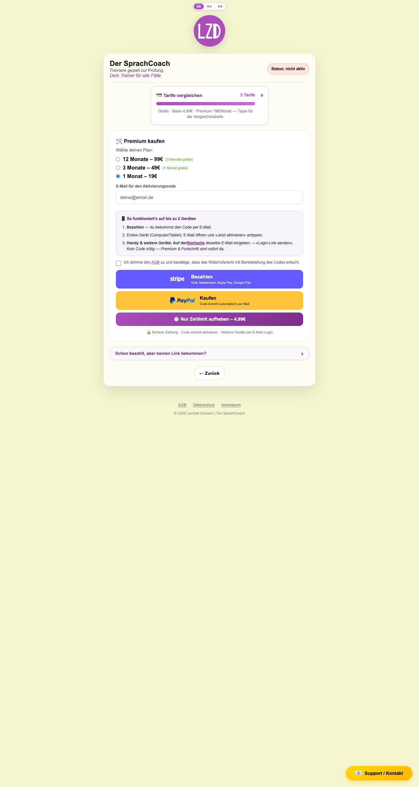
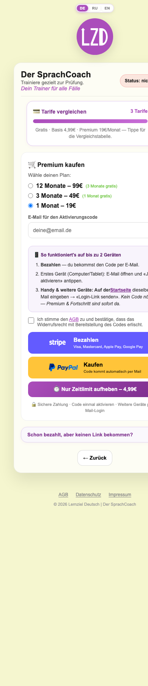

# 03 — Premium (Checkout / Activation / Hub)

Source: `src/site/views/Premium.vue`. Related: `PricingCompare.vue`, `PaymentButtonLabel.vue`, `PaymentProviderLogo.vue`, `DeviceGuide.vue`, `ConversionSheet.vue`, `TrainingHubPanel.vue`, `NiveauTestBlock.vue`, `src/site/composables/usePremium.js`, `src/site/utils/premiumAccess.js`, `src/site/data/payment.js`, `src/site/utils/api.js`, `src/site/components/BootstrapHandler.vue`.

---

## 1. Route & access

| Aspect | Value |
|---|---|
| Path / name | `#/premium`, `premium` (`src/site/router/index.js:28`) — hash history (`src/site/router/index.js:24`) |
| Guard: already Premium | If `isPremium` and `query.focus !== 'basis'` → redirect to `landing` (`src/site/router/index.js:48-50`). |
| Guard: trainer → premium | `/trainer` with a Premium-only query (`mode` ∈ `schwaechen|placement|premium|vocab`, or non-empty `topic`/`set`; `src/site/utils/premiumAccess.js:9-17`) while not Premium, with backend and entitlements ready → redirect to `premium?hub=1` (`src/site/router/index.js:52-56`). |
| Free / Basis | Full checkout view (locked view). |
| Premium | Only reachable with `?focus=basis` or when entitlements become Premium while already on the page (guard ran before bootstrap; `isPremium` is `false` until `entitlements.ready`, `src/site/composables/usePremium.js:602-608`). Shows the unlocked view. |
| Backend vs demo | `hasBackend()` = `SCRIPT_URL` non-empty (`src/site/utils/api.js:32-34`; URL set in `src/site/data/payment.js:32-33`). Demo activator only when no backend **and** `import.meta.env.DEV` (`src/site/views/Premium.vue:720-721`). In prod without backend, activation returns "Kein Backend konfiguriert." (`src/site/composables/usePremium.js:303-305`). |
| Bootstrap overlay | App shows "Zugriff wird geprüft…" (`common.checkingAccess`) until entitlements are ready, max 4 s (`src/site/App.vue:25`, `src/site/composables/usePremium.js:481-505`). |

### Query parameters

| Param | Effect | Source |
|---|---|---|
| `hub=1` | "Hub mode": shows `premium.hubBack` button at top, hides bottom back button, shows locked `NiveauTestBlock` + `TrainingHubPanel` preview for free users, Basis banner if Basis; preselects plan `3months` (free only); shows 🔑 Anmelden FAB if backend & not logged in. | `Premium.vue:81, 157, 376-383, 423-429, 878-886, 889`; `src/site/App.vue:31-36` |
| `focus=basis` | Replaces the Premium buy card with the Basis (Zeitlimit aufheben, 4,99 €) card; bypasses the Premium→landing guard. | `Premium.vue:79, 435-509, 512`; `router/index.js:48` |
| `plan=3months` | Preselects 3-month plan (default `1month`). | `Premium.vue:101, 156` |
| `level=A1|A2|B1|B2` | Initial level for `TrainingHubPanel` (else CEFR level from placement, else A1). Watched. | `Premium.vue:150-155, 160-167` |
| `#tarife` | Intended to auto-open PricingCompare (`PricingCompare.vue:67-71`) — see Open questions. | |

Entry-URL params handled app-wide by `BootstrapHandler.vue` (before the hash, per `src/site/data/payment.js:42-47`):
- `?activate=CODE` → code stored in `sessionStorage.pendingActivationCode`, navigate to `premium?hub=1` (`BootstrapHandler.vue:105-116`).
- `?mltoken=TOKEN` → validates magic link, sets session, merges server progress, activates pending/linked code, then routes to landing if paid (`BootstrapHandler.vue:124-210`).
- `?stripe_success=1` → green success banner, navigate to landing after 2 s (`BootstrapHandler.vue:93-99`).

## 2. Purpose

Sell Premium (1/3/12 months) or Basis (one-off "Zeitlimit aufheben") via hosted Stripe Payment Links or PayPal.me; after payment, let the user log in by magic link and activate the e-mailed code. For free users in hub mode it also previews the locked Premium training hub. For active Premium users it shows a stats summary + training hub + dashboard.

## 3. Layout

Desktop:  · Mobile: 
(Screenshots: free user, no `hub`, no `focus`, not logged in, backend on.)

Top to bottom (free / locked view):
1. Global: locale switcher DE/RU/EN (`src/site/App.vue:64`), `LzdLogo small` (`Premium.vue:369`).
2. Hub only: "← Zurück zum Start" button (`Premium.vue:376-383`).
3. Card header: title / subtitle / tagline (left, hidden when `showPremiumHero`) + status pill (red "Status: nicht aktiv" / green "Status: aktiv") (`Premium.vue:387-421`).
4. Hub + Basis + not Premium: Basis banner (`Premium.vue:423-429`).
5. `PricingCompare` collapsible (`Premium.vue:433`).
6. Either Basis card (`focus=basis`, `Premium.vue:435-509`) **or** Premium buy card (`Premium.vue:511-641`): plan radios → e-mail input (or "Code nach Zahlung an: <email>" when logged in) → `DeviceGuide variant="buy"` → AGB checkbox → Stripe button → PayPal button → lilac "⏱️ Nur Zeitlimit aufheben – 4,99€" → secure footer → status line.
7. Activation area (exactly one of, backend only unless noted):
   - Pending code & not logged in: "✉️ Fast geschafft!" magic-link form (`Premium.vue:644-676`).
   - Logged in: "🔑 Aktivierungscode" form with sign-out (`Premium.vue:679-717`).
   - No backend & DEV: demo activator (`Premium.vue:720-760`).
   - Otherwise: collapsed `
` "Schon bezahlt, aber keinen Link bekommen?" (`Premium.vue:763-787`).
8. Hub only (free): `NiveauTestBlock` (locked) + `TrainingHubPanel :locked="true"` (`Premium.vue:878-886`).
9. Non-hub: "← Zurück" button (`Premium.vue:888-900`).
10. `LegalFooter` (AGB · Datenschutz · Impressum, ©) (`Premium.vue:904`); FAB stack (🔑 Anmelden in hub when eligible; 📧 Support / Kontakt) (`src/site/App.vue`).
11. `ConversionSheet` bottom sheet (closed by default; `Premium.vue:906-910`).

Premium (unlocked) view, replacing 5–9:
1. Hero "Der SprachCoach" + slogan above card when not hub (`Premium.vue:371-374`).
2. Stats card: `Lv{n}` badge (level colour), level name, "⭐ X XP · noch N XP bis Lv{n+1}" / "Max. Level!", "🏅 Mein Profil" button; streak grid (Tage aktuell / Rekord 🏆 / Freezes) + medals (`Premium.vue:792-848`).
3. `DailyGoalCard variant="reminder"` (`Premium.vue:850`), `NiveauTestBlock` (`Premium.vue:852`).
4. `TrainingHubPanel :locked="false"` (`Premium.vue:856-861`).
5. Divider "Dein Fortschritt" + `SchwaechenCard` + `ActivityCalendar` (`Premium.vue:863-875`).

## 4. Elements & behavior

| Element | DE text · i18n key | Interaction / result |
|---|---|---|
| Hub back | "← Zurück zum Start" · `premium.hubBack` | → `landing` (`Premium.vue:358-364`). |
| Title block | "Der SprachCoach" / "Trainiere gezielt zur Prüfung." / "Dein Trainer für alle Fälle" · `premium.title`, `premium.subtitle`, `premium.tagline` | Static. |
| Status pill | "Status: nicht aktiv" / "Status: aktiv" · `premium.statusInactive` / `premium.statusActive` | Red / green styling by `isPremium` (`Premium.vue:413-419`). Basis users still see "nicht aktiv". |
| Basis banner | "⏱️ Basis aktiv — unbegrenzte Zeit. Themen-Training nur mit 💎 Premium." · `premium.hubBasisBanner` | `role="status"`; only hub + Basis + not Premium. |
| PricingCompare summary | "💳 Tarife vergleichen", "3 Tarife", hint "Gratis · Basis 4,99€ · Premium 19€/Monat — Tippe für die Vergleichstabelle." · `landing.compareTitle`, `landing.compareCount`, `landing.compareHint` | Click toggles `
`; full progress bar decorative (`PricingCompare.vue:74-99`). |
| PricingCompare table | Columns "Kostenlos" / "⏱️ Basis" / "💎 Premium" (`common.free/basis/premium`); rows `landing.pricing.noLimit` ("Kein Zeitlimit", free = "{N} Min"), `levels`, `streak`, `errorAnalysis`, `byTopic`, `placementTest`, `grammarTips`, `streakFreeze`, `dictionary`; price row "Preis": "Gratis" / "4,99€ einmalig" / "19€/Monat" (`common.price`, `common.gratis`, `common.once`, `common.perMonth`) | Read-only matrix (`PricingCompare.vue:20-65, 101-138`). Prices from `PRICES_EUR` (`src/site/data/payment.js:93-98`). |
| Buy card heading | "🛒 Premium kaufen" / "Wähle deinen Plan:" · `premium.buyTitle`, `premium.choosePlan` | Static. |
| Plan radios | "12 Monate – 99€" (+ "(3 Monate gratis)"), "3 Monate – 49€" (+ "(1 Monat gratis)"), "1 Monat – 19€" · `premium.plan12/plan3/plan1`, `common.monthsFree3`, `common.monthFree1` | Single choice → `plan` (`Premium.vue:109-113, 528-550`). Default `1month`; `3months` with `?plan=3months` or hub. |
| E-mail input (not logged in) | Label "E-Mail für den Aktivierungscode" · `premium.emailLabel`; placeholder "deine@email.de" · `common.emailPlaceholder` | `buyEmail`, prefilled from `auth.email` or `localStorage.userEmail` (`Premium.vue:71`). |
| E-mail line (logged in) | "Code nach Zahlung an: **<email>**" · `premium.codeTo` | Uses session e-mail. |
| DeviceGuide (buy/basis) | "📱 So funktioniert's auf bis zu 2 Geräten"; steps `deviceGuide.stepPayBold`+`stepPayRest`, `stepFirst`, `stepOther` + link "Startseite" (`common.homepage`) + `stepOtherLink` + `stepOtherEndPremium`/`stepOtherEndBasis` | "Startseite" link → `landing` (`DeviceGuide.vue:23-41`). |
| AGB checkbox | "Ich stimme den **AGB** zu und bestätige, dass das Widerrufsrecht mit Bereitstellung des Codes erlischt." · `common.agbAcceptBefore`, `common.agb`, `common.agbAcceptAfter` | `agbChecked` (shared by all pay buttons). AGB link → `legal/agb` with `target="_blank"` (`Premium.vue:573-598`). |
| Stripe button | Logo + "Bezahlen" / "Visa, Mastercard, Apple Pay, Google Pay" · `premium.payStripe`, `premium.stripeSub` | `validateBuyForm()` → `window.open(STRIPE_LINKS[plan]?prefilled_email=…, '_blank', 'noopener')`; status "💳 Stripe-Seite geöffnet. Nach der Zahlung erhältst du deinen Code per E-Mail an {email}." (`premium.stripeOpened`, colour #635BFF) (`Premium.vue:198-206`; URL `src/site/data/payment.js:108-111`). |
| PayPal button | Logo + "Kaufen" / "Code kommt automatisch per Mail" · `premium.payPaypal`, `premium.paypalSub` | Validate → open `https://paypal.me/lehrermann/{19EUR|49EUR|99EUR}` (no e-mail prefill); status `premium.paypalOpened` (#0070BA) (`Premium.vue:212-220`; `payment.js:131-134`). |
| Lilac Basis quick-buy | "⏱️ Nur Zeitlimit aufheben – 4,99€" · `funnel.basisQuick` | Same as Basis Stripe (`payBasis`, `Premium.vue:244-251`) — opens Stripe Basis link; status `premium.basisStripeOpened`. |
| Secure footer | "🔒 Sichere Zahlung · Code einmal aktivieren · Weitere Geräte per E-Mail-Login" · `premium.securePremium` | Static. |
| Validation errors | "✖ Bitte deine E-Mail für den Code eingeben." (`premium.errEmailForCode`), "✖ Keine E-Mail in der Sitzung." (`premium.errNoSessionEmail`, logged-in w/o e-mail), "✖ Bitte stimmen Sie den AGB zu." (`premium.errAgb`) | Red (#ed4545) status under buttons; on success e-mail saved to `localStorage.userEmail` (`Premium.vue:175-192`). E-mail check is only `includes('@')`. |
| Basis card (`focus=basis`) | Title "⏱️ Zeitlimit aufheben – 4,99€" (`premium.basisTitle`), intro `premium.basisIntro`, e-mail input or "📧 Code an: <email>" (`premium.codeToEmail`), DeviceGuide basis, AGB, Stripe "Bezahlen – 4,99€" (`premium.payBasis`), PayPal "Kaufen – 4,99€" (`premium.buyBasis`), footer `premium.secureBasis`, link "💎 Stattdessen Premium ab 19€/Monat" (`premium.altPremium`) | Stripe → `STRIPE_BASIS_LINK` + prefill; PayPal → `paypal.me/lehrermann/4.99EUR`; status `premium.basisStripeOpened` / `basisPaypalOpened`. Alt link → `premium` without query (`Premium.vue:435-509`). |
| Pending-code login | "✉️ Fast geschafft!" (`premium.almostDone`), intro `premium.pendingIntro`, e-mail input, button "📧 Login-Link senden" / "Wird gesendet…" (`premium.sendLoginLink`, `common.sending`), hint `premium.inboxHint`, `DeviceGuide compact` (`deviceGuide.compactBefore/After`) | `submitMagicLink()` → `requestMagicLink(email)`; success "✔ Anmelde-Link an {email} gesendet." (`premium.magicLinkSent`) or delayed `login.linkSentDelayed`; error "✖ …" / `premium.magicLinkErr`; invalid e-mail `login.errInvalidEmail` (`Premium.vue:307-336`). Button disabled while sending. |
| Activation form (logged in) | "🔑 Aktivierungscode" (`premium.codeTitle`), "✅ <email>" + "Abmelden" (`common.signOut`), optional hint `premium.pendingCodeHint`, input placeholder "Code aus der E-Mail (z.B. PREMIUM-…)" (`premium.codePlaceholder`), button "Code aktivieren" / "Wird überprüft…" (`premium.activateCode`, `premium.checking`) | `submitCode()`: empty → `login.errEnterCode`; backend & not logged in → `premium.errLoginFirst`; else `activateCode(code, auth.email)`. OK → "✔ Premium aktiviert!" / "✔ Zeitlimit aufgehoben!" (`login.premiumActivated` / `login.basisActivated`), clear pending code, reload after 1.5 s. Fail → "✖ {error}" (`Premium.vue:267-300`). Abmelden → `signOutUser()` then hard navigate to landing (`Premium.vue:339-342`). |
| Demo activator (DEV, no backend) | "🔑 Aktivierungscode (Demo)" (`premium.codeDemoTitle`), placeholder "z.B. PREMIUM_DEMO oder BASIS_TEST" (`premium.codeDemoPlaceholder`) | Prefix `PREMIUM*` → Premium 30 days; `BASIS*` → Basis; else "Ungültiger Code. Tipp: starte mit PREMIUM… oder BASIS… (Demo-Modus)." (`usePremium.js:269-290`). |
| Manual fallback | `
` "Schon bezahlt, aber keinen Link bekommen?" (`premium.manualTitle`), hint `premium.manualHint`, e-mail + "📧 Login-Link senden" | Same `submitMagicLink()` (`Premium.vue:763-787`). |
| Hub preview (free) | `NiveauTestBlock` (`landing.niveauTest`, `landing.niveauHintLocked`), `TrainingHubPanel` locked | Locked taps open `ConversionSheet` variant `niveau` / `checkout`, plan `3months` (`Premium.vue:348-356, 906-910`). |
| Bottom back | "← Zurück" · `premium.back` | → `landing`. Hidden in hub and for Premium. |
| Premium stats | "Lv{n}", level name, "⭐ {xp} XP · noch {xp} XP bis Lv{level}" (`premium.xpUntil`) / "Max. Level!" (`premium.maxLevel`), "🏅 Mein Profil" (`landing.profileBtn`), "Tage aktuell" / "Rekord 🏆" / "Freezes" (`premium.streakCurrent/Record/Freezes`), medals string | Profile button → `profile` (`Premium.vue:344-346`). |
| Dashboard divider | "Dein Fortschritt" · `landing.sectionDashboard` | Contains `SchwaechenCard`, `ActivityCalendar` (see 04-profile §4.3). |
| `PaymentButtonLabel` | props `provider` (`stripe|paypal`), `main`, `sub` | Renders logo + two-line copy (`PaymentButtonLabel.vue:4-22`). |
| `PaymentProviderLogo` | `alt=""` (decorative) | `/payment/stripe-white.svg` or `/payment/paypal.svg` (`PaymentProviderLogo.vue:16-21`). |

## 5. States & variants

| State | Rendering |
|---|---|
| Free, not logged in, backend (screenshot) | Locked view; e-mail input; manual fallback `
`; plan default 1 Monat. |
| Free, logged in | E-mail input replaced by "Code nach Zahlung an"; activation form with sign-out shown instead of manual fallback. |
| Pending code (`?activate=`), not logged in | "Fast geschafft!" magic-link form; after login via link, `BootstrapHandler` auto-activates pending code (`BootstrapHandler.vue:156-174`). |
| Pending code, logged in | Code input prefilled + hint `premium.pendingCodeHint`. |
| Basis active | Status still "nicht aktiv"; in hub, Basis banner; buy UI still offered (upgrade). |
| `focus=basis` | Basis card instead of Premium buy card; Premium user is allowed in and sees unlocked view (Basis card hidden since `!isPremium` block not rendered). |
| Hub (`hub=1`) | Top back button, no bottom back, locked hub preview, plan default 3 Monate, 🔑 FAB. `.app-shell--premium-hub` class. |
| Premium | Unlocked view (see §3). |
| Demo (no backend, DEV) | Demo activator; no magic-link UI, no manual fallback. Prod w/o backend: no activation UI at all. |
| Loading | Bootstrap overlay; buttons show "Wird gesendet…" / "Wird überprüft…" and are disabled. |
| Backend degraded | Global banner `backendDegraded.message` (`src/site/App.vue:55-61`); grace snapshot keeps access (`usePremium.js:92-103, 456-461`). |
| Error | Inline red status lines (validation, server error, DEVICE_LIMIT toast on magic link `BootstrapHandler.vue:139-145`). |
| Mobile | Single column, same order (premium-mobile.png). |

## 6. Data & persistence

| Item | Storage / endpoint | Source |
|---|---|---|
| Activation codes `{premiumCode, basisCode}` | `localStorage.lzd_premium` | `usePremium.js:32, 106-108` |
| Code session token / expiry | `sessionStorage.lzd_premium_session_token`, `lzd_premium_session_expires` | `usePremium.js:33-34, 221-252` |
| Entitlements `{ready,isPremium,isBasis,premiumExpires}` | memory only; grace snapshot via `backendGrace.js` | `usePremium.js:58-63, 71-86` |
| Training JWT | memory only | `usePremium.js:55` |
| Magic session `{email, sessionToken, sessionExpires}` | `localStorage.lzd_user_v1` | `useAuth.js:12, 40-46` |
| Checkout e-mail | `localStorage.userEmail` (removed on sign-out) | `Premium.vue:62, 190`; `usePremium.js:599` |
| Pending code | `sessionStorage.pendingActivationCode` | `Premium.vue:64, 128-146`; `BootstrapHandler.vue:43` |
| GAS actions (SCRIPT_URL) | `validateCode` (`api.js:218`), `validateMagicToken` (`api.js:238`), `requestMagicLink` (`api.js:257`), `refreshMagicSession` (`api.js:288`), `revokeMagicSession` (`api.js:304`) | |
| Hosted checkout | Stripe Payment Links `STRIPE_LINKS` / `STRIPE_BASIS_LINK` (`payment.js:66-73`); PayPal.me `PAYPAL_HANDLE` + `PAYPAL_AMOUNTS` (`payment.js:82-90`) | |
| Worker | Not called by this page. `worker/index.js:379` `/api/questions` consumes the training JWT obtained here; `/api/health` (`worker/index.js:376`). | |

Activation flow (backend): `activateCode` clears code session → `validateCode(code, email, '')` → requires `sessionToken`+`sessionExpires` (else "Ungültige Server-Antwort.") → stores code (Basis XOR Premium), session token, entitlements, grace snapshot (`usePremium.js:299-364`).

## 7. Navigation

- In: Landing «Mehr: Tarife» (`hub=1`), Basis CTAs (`focus=basis`), trainer guard (`hub=1`), Profile upsell (`hub=1`), `BonusMissionsCard` premium mission (no query), `?activate=` e-mail link.
- Out: `landing` (back buttons, guard, after sign-out via `window.location.assign`, after `stripe_success`), `profile` (Premium stats), `legal/agb` (new tab), Stripe / PayPal (new tab), `trainer` (via `TrainingHubPanel`/`NiveauTestBlock` when Premium), `premium` (Basis alt link).

## 8. Acceptance criteria

1. Visiting `#/premium` as Premium (entitlements ready) without `focus=basis` redirects to `#/`.
2. Visiting `#/premium?focus=basis` as Premium renders the status pill "Status: aktiv" and the stats card.
3. As free user without query, plan "1 Monat – 19€" is preselected; with `?hub=1` or `?plan=3months`, "3 Monate – 49€" is preselected.
4. Clicking Stripe/PayPal/lilac button with empty or `@`-less e-mail shows "✖ Bitte deine E-Mail für den Code eingeben." and opens no window.
5. With valid e-mail but unchecked AGB, any pay button shows "✖ Bitte stimmen Sie den AGB zu." and opens no window.
6. With valid e-mail + AGB, Stripe opens `buy.stripe.com/...` for the selected plan with `prefilled_email=<urlencoded lowercased email>` in a new tab, and `localStorage.userEmail` equals that e-mail.
7. PayPal opens `https://paypal.me/lehrermann/19EUR|49EUR|99EUR` matching the plan; Basis PayPal opens `.../4.99EUR`.
8. `?focus=basis` hides the Premium buy card and shows the Basis card with "⏱️ Zeitlimit aufheben – 4,99€".
9. Opening `/?activate=abc#/` stores `ABC` in `sessionStorage.pendingActivationCode` and lands on `#/premium?hub=1` showing "✉️ Fast geschafft!" (not logged in, backend on).
10. Logged in, submitting an empty code shows "✖ Bitte Code eingeben."; a valid code shows "✔ Premium aktiviert!" and reloads after ~1.5 s.
11. Backend on and not logged in, the "Schon bezahlt, aber keinen Link bekommen?" `
` is shown (unless a pending code exists).
12. "📧 Login-Link senden" with invalid e-mail shows "✖ Bitte gültige E-Mail eingeben."; button is disabled and reads "Wird gesendet…" while pending.
13. "Abmelden" clears `lzd_user_v1`, `lzd_premium`, `userEmail`, code session, and navigates to landing.
14. In DEV with empty `SCRIPT_URL`, code `PREMIUM_X` activates Premium; `FOO` shows the demo error text.
15. Trainer URL `#/trainer?level=A1&topic=x` as free user (backend, ready) redirects to `#/premium?hub=1`.
16. PricingCompare is collapsed by default and expands on summary click, showing 9 feature rows + price row.
17. Hub mode shows "← Zurück zum Start" at top and no bottom "← Zurück"; free hub shows locked training hub; locked taps open the conversion sheet.
18. At 390 px width, the page has no horizontal scroll (see Open questions).

## 9. Open questions / observations

1. **Mobile overflow**: `premium-mobile.png` shows the card clipped on the right (status pill "Status: nic…", buttons cut). Verify whether the page overflows horizontally at 390 px or it is a capture artefact.
2. **DeviceGuide missing space**: screenshot renders "Auf der**Startseite**" — whitespace between `</strong>` and `<router-link>` (`DeviceGuide.vue:32-33`) is condensed by the Vue compiler.
3. **`#tarife` auto-open is unreachable** in hash routing: `window.location.hash` is `#/premium…`, never `#tarife` (`PricingCompare.vue:68`).
4. **Unlocked view reachable only via `focus=basis`** (or race before bootstrap). The file header (`Premium.vue:12-17`) describes a Premium home that the guard now prevents; consider removing dead UI or documenting the intent.
5. `goPremiumBack` has identical branches (`Premium.vue:358-364`).
6. Status pill shows "nicht aktiv" for Basis users — no Basis-specific status.
7. `validateBasisCheckout` duplicates `validateBuyForm` (`Premium.vue:175-192` vs `227-242`); logged-in-without-e-mail message differs between them.
8. Lilac "Nur Zeitlimit aufheben" uses the Premium card's AGB checkbox and goes straight to Stripe (no PayPal option, no Basis DeviceGuide).
9. Hard-coded German errors from `usePremium.js` (e.g. "Ungültiger Code.", "Ungültige Server-Antwort.") and `BootstrapHandler.vue` toasts bypass i18n.
10. E-mail validation is only `includes('@')`.
11. `STRIPE_AMOUNT_MAP` contains both 9900 and 9000 for 12 months (`payment.js:58-63`) — confirm legacy price.
12. PayPal.me flow cannot carry the buyer e-mail; how the backend maps PayPal payments to the entered e-mail is not visible in this repo.
