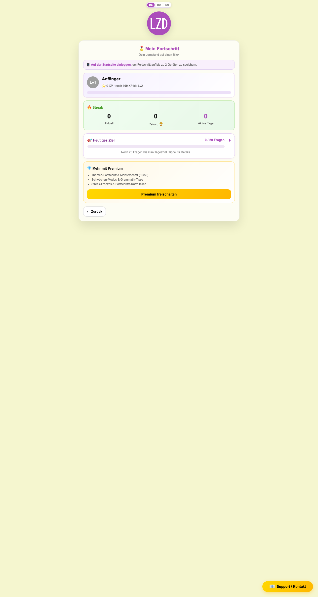
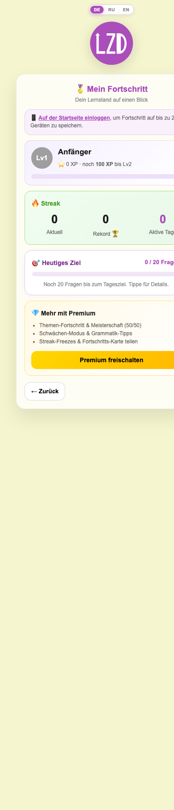

# 04 — Profile (Mein Fortschritt / Mein Profil)

Source: `src/site/views/Profile.vue`. Cards: `DailyGoalCard.vue`, `DailyGoalDetailModal.vue`, `ShareProgressCard.vue` (+ `src/site/utils/shareCard.js`). Related cards documented here but **not rendered on Profile** (see §9): `BonusMissionsCard.vue`, `SchwaechenCard.vue`, `ActivityCalendar.vue`. Composables: `useXp`, `useStreak`, `useDailyGoal`, `useDailyBonus`, `useCefrLevel`, `useNickname`, `useAuth`, `usePremium`, `useProgressSync`; util `progressMerge.js`.

---

## 1. Route & access

| Aspect | Value |
|---|---|
| Path / name | `#/profile`, `profile` (`src/site/router/index.js:29`) |
| Guards | None — open to everyone (`src/site/router/index.js:43-59`). |
| Free / Basis | **Mini profile** (`Profile.vue:80-189`), rendered when `!isPremium`. |
| Premium | **Full profile** (`Profile.vue:191-365`). |
| Backend vs demo | With backend `isPremium` is false until entitlements are ready (`usePremium.js:602-608`); the app overlay "Zugriff wird geprüft…" covers the page meanwhile (`src/site/App.vue:25`). Demo (no backend, DEV) uses locally activated codes. Progress sync only with backend. |
| Logged-in | `useAuth().isLoggedIn` = email + token + non-expired `sessionExpires` (`useAuth.js:34-37`). |

No query params are read.

## 2. Purpose

Learner dashboard: XP level, streak, today's goal; for Premium additionally placement (CEFR) result, nickname, shareable progress card (Post/Story PNG) and topic mastery. Free users get an upsell to Premium and a hint to log in for cross-device sync.

## 3. Layout

Desktop (free, logged out):  · Mobile: 

### 3.1 Mini profile (Free / Basis), top to bottom
1. Global locale switcher, `LzdLogo small` (`Profile.vue:78`).
2. Head "🏅 Mein Fortschritt" / "Dein Lernstand auf einen Blick" (`Profile.vue:82-85`).
3. Account row (logged in: "👤 <email>" + "Abmelden") **or** login hint box (`Profile.vue:87-102`).
4. XP block: level badge, level name, XP line, progress bar (`Profile.vue:105-135`).
5. Streak block "🔥 Streak": Aktuell / Rekord 🏆 / Aktive Tage; medals if record > 0 (`Profile.vue:138-159`).
6. `DailyGoalCard` (default variant) (`Profile.vue:161`).
7. Upsell "💎 Mehr mit Premium" + 3 bullets + "Premium freischalten" (`Profile.vue:164-178`).
8. "← Zurück" (`Profile.vue:180-187`).
9. Support FAB (global). No LegalFooter, no 🔑 FAB on this route (`src/site/App.vue:31-36`).

### 3.2 Full profile (Premium), top to bottom
1. Header "🏅 Mein Profil" + account row ("👤 <email>" or "💎 Premium aktiv") + "Abmelden" (`Profile.vue:193-203`).
2. XP block (same content as mini) (`Profile.vue:206-236`).
3. Streak block: Aktuell / Rekord 🏆 / Freezes + medals (always) (`Profile.vue:239-260`).
4. Placement block "📊 Einstufungtest · {CEFR}" with per-level rows, only if CEFR level exists (`Profile.vue:262-282`).
5. Nickname input (`Profile.vue:284-297`).
6. `ShareProgressCard` live preview with Post/Story toggle (`Profile.vue:299-308`).
7. Collapsible "📚 Alle Themen" mastery (`Profile.vue:311-342`).
8. Share button, note, "← Zurück" (`Profile.vue:344-363`).

## 4. Elements & behavior

Profile.vue has **no i18n keys** except `common.signOut`; all other strings are hard-coded German (quoted with `Profile.vue:line`).

### 4.1 Profile.vue

| Element | DE text · key / location | Interaction / result |
|---|---|---|
| Mini head | "🏅 Mein Fortschritt", "Dein Lernstand auf einen Blick" · `Profile.vue:83-84` | Static. |
| Login hint (free, logged out) | "📱 **Auf der Startseite einloggen**, um Fortschritt auf bis zu 2 Geräten zu speichern." · `Profile.vue:100-101` | Link → `landing` (login lives there: `LoginPanel`/`LoginModal`, opened via `useLoginModal`). |
| Account row | "👤 <email>" + "Abmelden" · `common.signOut` | `signOutUser()` (revoke magic session, clear `lzd_user_v1`, `lzd_premium`, grace, `userEmail`) then `window.location.assign('#/')` (`Profile.vue:70-73`; `usePremium.js:584-600`). |
| Premium account label | "👤 <email>" if logged in, else "💎 Premium aktiv" · `Profile.vue:197` | "Abmelden" is shown even when not logged in (see §9). |
| Level badge | "Lv{num}", background = level colour | Levels: 1 Anfänger 0+, 2 Lernender 100+, 3 Fortgeschrittener 500+, 4 Profi 1500+, 5 Meister 4000+ (`useXp.js:81-87`). |
| XP line | "⭐ {totalXP} XP · noch **{n} XP** bis Lv{num+1}" or "· **Maximales Level!**" · `Profile.vue:116-122`, `217-223` | `xpToNext = next − totalXP` (`Profile.vue:47`). |
| XP bar | — | Width = `(totalXP − prev)/(next − prev)` clamped 0–100; 100 % at max (`Profile.vue:48-53`). Gradient level colour → #AB4DBB. |
| Streak (mini) | "🔥 Streak"; "Aktuell", "Rekord 🏆", "Aktive Tage" · `Profile.vue:139-153` | Aktive Tage = `streak.activeDays.length` (≤ 42) (`Profile.vue:33`). Medals only if `longestStreak > 0`. |
| Streak (full) | "Aktuell", "Rekord 🏆", "Freezes" · `Profile.vue:244-254` | Medals line always: earned 🥉3 🥈7 🥇14 💎30 👑60 🌟100 + "▫" padding to 6 (`useStreak.js:165-178`). |
| Upsell | "💎 Mehr mit Premium"; "Themen-Fortschritt & Meisterschaft (50/50)", "Schwächen-Modus & Grammatik-Tipps", "Streak-Freezes & Fortschritts-Karte teilen"; button "Premium freischalten" · `Profile.vue:165-176` | → `premium?hub=1` (`Profile.vue:174`). |
| Back | "← Zurück" · `Profile.vue:186`, `361` | → `landing`. |
| Placement block | "📊 Einstufungtest · {A1–B2}"; rows "{level} {correct}/{total} ({pct}%)", active level highlighted; "{pct}% richtig gesamt" · `Profile.vue:264-281` | Rows from `placementBreakdown(cefrState.scores)` (`src/site/utils/placementTest.js:171-177`). Summary hidden when 0 %. |
| Nickname | Label "✏️ Dein Nickname", placeholder "Lernender", hint "Erscheint auf deiner Erfolgs-Karte" · `Profile.vue:285-296` | `maxlength=24`; saved on `change` and `blur` via `setNickname` (trim, slice 24) to `lzd_nickname`; empty → display name "Lernender" (`useNickname.js:18-26`). Preview redraws live. |
| Topics `
` | Summary "📚 Alle Themen" · "{mastered} / {total} gemeistert" · `Profile.vue:313-314` | Collapsed by default. Body: overall bar (`themePct`), per level A1/A2/B1/B2 chips; mastered chip "✅ {name}" with done style; tooltip "{name}: {correct}/50 richtig" (`Profile.vue:316-341`). Mastery = ≥ 50 correct in topic (`useXp.js:18, 116-119`). Topic counts: A1 11, A2 21, B1 28, B2 24 = 84 (`src/site/data/premiumTopics.js:13`). |
| Share button | "📤 Post teilen (1080×1080)" / "📤 Story teilen (1080×1920)" · `Profile.vue:348-350` | `shareProgressCard({... format})` (`Profile.vue:57-68`) → see §4.4. |
| Share note | "Auf dem Handy direkt in Instagram oder Facebook teilen — sonst wird das Bild heruntergeladen." · `Profile.vue:354` | Static. |

### 4.2 DailyGoalCard / DailyGoalDetailModal

| Element | DE text · i18n key | Interaction / result |
|---|---|---|
| Card title | "🎯 Heutiges Ziel" / "✅ Tagesziel geschafft!" · `dailyGoal.title` / `dailyGoal.titleDone` | Whole card is `role="button"`, `tabindex=0`, aria-label "Tippe für Details" (`common.tapForDetails`); click / Enter / Space opens modal (`DailyGoalCard.vue:39-51`). |
| Count | "{today} / {goal} Fragen" · `dailyGoal.count` | Goal = 20 (`useDailyGoal.js:13`). |
| Bar | — | `role=progressbar`, width `progressPct` (min(100, today/20)). |
| Hint | `dailyGoal.hintOne` ("Noch {count} Frage bis zum Tagesziel. Tippe für Details."), `dailyGoal.hintMany`, `dailyGoal.hintDone` ("Super — dein Streak ist gesichert. Tippe für Bonus & XP-Infos.") | Singular when 1 remaining (`DailyGoalCard.vue:21-27`). |
| Variant | `variant="reminder"` (used on Premium page) adds compact classes | Profile uses default. |
| Modal | Title "🎯 Tagesziel & XP" / "✅ Tagesziel & Bonus"; close "×" (aria "Schließen"); sections "Heutiges Ziel", "Dein Niveau (Premium)", "Dein Fortschritt", "XP im Training", "Bonus-Aufgaben" (+ "nach 20 Fragen" when locked), "Tages-Meilensteine" — hard-coded (`DailyGoalDetailModal.vue:47-162`) | Teleported to `body`; closes on × or backdrop click (`DailyGoalDetailModal.vue:34-36`). XP: ±1 per answer free, ±2 Premium ("(Premium ×2)"); +1 XP per correct after goal (`POST_GOAL_BONUS_XP`); mastery at 50. Missions filtered: `premium:true` missions hidden for non-Premium. Mission progress shown only after goal met ("—" otherwise). Milestones 25/30/35 questions → +5/+8/+12 XP (`useDailyBonus.js:16-20`). No Esc-to-close, no focus trap. |

### 4.3 Related cards (not on Profile; used on Landing / Premium)

| Card | Key texts · i18n | Behavior |
|---|---|---|
| `BonusMissionsCard` (Landing `Landing.vue:217`) | Hard-coded: "🏅 Bonus-Aufgaben für heute", "{done} / {n} erledigt", intro, "✅ Belohnt", "🎁 Wird im Training gutgeschrieben", CTA "▶ {ctaLabel}" or "💎 Premium", "📈 Tages-Meilensteine" | Only rendered when daily goal met (`BonusMissionsCard.vue:36`). CTA → mission `cta` route (trainer, `mode=premium`) or `premium` if Premium-only (`BonusMissionsCard.vue:22-28`). Missions: 5 Bonus-Fragen (+5), level mission (+4), Perfekte Serie (+6) or Premium "Schwäche: {topic}" (+8) (`useDailyBonus.js:85-155`). State `localStorage.lzd_daily_bonus`. |
| `SchwaechenCard` (Landing `:219`, Premium `:872`) | `schwaechen.*` — title "🎯 Schwächen-Modus", counts `countPremium`/`countEmpty`/`countSummary`, hints, `unlock`, `toTopics`, `listTitle`, `train`, `errorCount` | `
`; free: upsell emits `locked`; Premium w/o errors: "Zu den Premium-Themen →" → landing; with errors: top-3 weakest topics, "▶ Schwächen trainieren" → `trainer?mode=schwaechen`. Bar = errors/30. |
| `ActivityCalendar` (Landing `:218`, Premium `:873`) | `calendar.title` "📅 Aktivitätenkalender", `calendar.count` "{active} / 42 Tage", `hintEmpty`/`hintActive`, `dayLabels`, `legendLess`/`legendActive`/`legendToday` | `
` 6×7 grid of last 42 days from `streak.activeDays`; today outlined; cell tooltip = ISO date. |

### 4.4 ShareProgressCard + shareCard.js

| Element | DE text | Interaction / result |
|---|---|---|
| Head | "📤 Deine Erfolgs-Karte"; hint "Quadrat 1080×1080 · ideal für Feed" / "Vertikal 1080×1920 · ideal für Stories" (`ShareProgressCard.vue:88-92, 132-133`) | — |
| Format tabs | "Post" / "Story" (`role=tab`, `aria-selected`) | Sets `v-model:format` (shared with Profile's share button) (`ShareProgressCard.vue:136-182`). |
| Canvas preview | `aria-hidden` | Redrawn at container width × DPR (≤2) on mount, resize (ResizeObserver) and data changes (`ShareProgressCard.vue:32-63, 98-122`). |
| Tagline | e.g. "Zwei Wochen Streak! 🔥", "Eine Woche jeden Tag! 🔥", "Grammatik-Profi! 📚", "Erstes Thema gemeistert! ✅", "Auf dem Weg zum Profi! 💪", "Ich bleibe dran! 🇩🇪", "Einstufungtest: Niveau {X}! 📊", "Deutsch lernen — jeden Tag! ✨" | Priority order `shareCard.js:73-83`. |
| Badges | "📊 Einstufung {X}" + 🔥7 Tage, 💪14 Tage, 🏆30 Tage, ✅1. Thema, 📚10 Themen, 🎓25 Themen, ⭐500 XP, 💎1500 XP, 🚀Lv3+, 👑Meister | `shareCard.js:34-45, 89-101`. Hidden if none. |
| Share action | — | `shareProgressCard`: canvas → PNG blob; if `navigator.canShare({files})` → `navigator.share({files, title:'Mein Deutsch-Fortschritt', text:'{tagline} — Der SprachCoach'})`; else download `mein-fortschritt-sprachcoach.png` / `mein-fortschritt-story-sprachcoach.png` (`shareCard.js:864-905`). Errors / cancel silently ignored. |

## 5. States & variants

| State | Rendering |
|---|---|
| Free, logged out (screenshot) | Mini; login hint; Lv1 Anfänger, 0 XP, "noch 100 XP bis Lv2"; 0/0/0; "0 / 20 Fragen"; no medals line. |
| Free / Basis, logged in | Mini with "👤 <email>" + Abmelden. |
| Premium, logged in | Full; "👤 <email>". |
| Premium via code only (not logged in) | Full; "💎 Premium aktiv" + Abmelden. |
| No placement taken | Placement block hidden; share card without CEFR. |
| Max level (≥ 4000 XP) | "Maximales Level!", bar 100 %. |
| Goal met | DailyGoalCard ✅ title + done hint; modal shows mission progress. |
| Loading (backend) | Global bootstrap overlay until entitlements ready (≤ 4 s); then mini→full switch is reactive. |
| Degraded backend | Global banner; Premium kept via grace snapshot. |
| Demo (no backend) | Same UI, no sync; Premium only in DEV via demo code. |
| Mobile | Single column (profile-mobile.png). |

## 6. Data & persistence

| Data | localStorage key | Source | Synced to server? |
|---|---|---|---|
| XP total, topic correct / wrong | `lzd_xp`, `lzd_topic_correct`, `lzd_topic_wrong` | `useXp.js:15-17` | Yes (`xpData`) |
| Streak `{currentStreak, longestStreak, freezes, lastActiveDate, activeDays≤42}` | `lzd_streak` | `useStreak.js:19-35` | Yes (`streakData`) |
| Daily goal `{date, count}` | `lzd_daily_goal` | `useDailyGoal.js:12` | Yes (`dailyGoalData`) |
| Daily bonus | `lzd_daily_bonus` | `useDailyBonus.js:13` | No |
| CEFR placement `{level, testedAt, scores, totalCorrect, totalAnswered}` | `lzd_cefr_level` | `useCefrLevel.js:8-35` | No (persist does not schedule push) |
| Nickname | `lzd_nickname` | `useNickname.js:10` | No |
| Auth session | `lzd_user_v1` | `useAuth.js:12` | — |
| Premium codes | `lzd_premium` | `usePremium.js:32` | — |

Sync (`useProgressSync.js`):
- **Pull** at app start after entitlement bootstrap: `loadProgress(email, token)` → GAS `loadProgressByEmail` (`api.js:339-341`), then `applyServerProgress` (`useProgressSync.js:32-71`; called `BootstrapHandler.vue:217`). Also applied from magic-link login response (`BootstrapHandler.vue:152`).
- **Merge** (`progressMerge.js`): streak = max of counters, later `lastActiveDate`, union of `activeDays` (last 42) (`:13-29`); XP = max total, per-topic max (`:36-52`); daily goal = today's max, else reset (`:59-69`).
- **Push**: any non-silent persist of XP/streak/daily goal schedules a debounced (800 ms) push (`useProgressSync.js:76-83`): logged in → `saveProgressByEmail` (`api.js:354`); else Premium with code → `saveStreakByCode` (streak only) (`useProgressSync.js:90-108`; `api.js:372`). Imports are silent to avoid echo.
- Streak rules: goal of 20 questions marks streak day; freezes (Premium only) earned every 7-day multiple (max 3) and consumed for a 1-day gap (`useStreak.js:115-144`).

## 7. Navigation

- In: Landing "🏅 Mein Profil" (`Landing.vue:93`), Premium stats "🏅 Mein Profil" (`Premium.vue:344-346`).
- Out: `landing` (Zurück, login hint link, after Abmelden via full reload), `premium?hub=1` (upsell). Daily-goal modal has no navigation.

## 8. Acceptance criteria

1. `#/profile` is reachable without login and without Premium (no redirect).
2. Non-Premium user sees "🏅 Mein Fortschritt"; Premium user sees "🏅 Mein Profil".
3. Logged-out free user sees the login hint; its link navigates to `#/`.
4. With 0 XP: badge "Lv1", "Anfänger", "⭐ 0 XP · noch 100 XP bis Lv2", bar width 0 %.
5. With 250 XP: "Lv2 Lernender", "noch 250 XP bis Lv3", bar 38 %.
6. With ≥ 4000 XP: "Lv5 Meister", "Maximales Level!", bar 100 %.
7. Mini streak shows `activeDays.length` under "Aktive Tage"; full shows `freezes` under "Freezes".
8. Mini medals line hidden when record = 0; shown as e.g. "🥉🥈▫▫▫▫" for record 7.
9. DailyGoalCard shows "{n} / 20 Fragen"; click, Enter or Space opens the modal; × and backdrop click close it.
10. "Premium freischalten" navigates to `#/premium?hub=1`.
11. Placement block appears only when `lzd_cefr_level.level` ∈ A1–B2, highlighting that level's row.
12. Nickname input accepts max 24 chars; on blur the value (trimmed) is saved in `lzd_nickname` and appears on the preview card; empty shows "Lernender".
13. Switching Post/Story updates the preview aspect, hint text and share button label (1080×1080 vs 1080×1920).
14. On a browser without file share support, the share button downloads `mein-fortschritt-sprachcoach.png` (Post) or `mein-fortschritt-story-sprachcoach.png` (Story).
15. "📚 Alle Themen" is collapsed by default; summary shows "{mastered} / 84 gemeistert"; a topic with ≥ 50 correct shows "✅ " prefix.
16. "Abmelden" clears `lzd_user_v1`, `lzd_premium`, `userEmail` and lands on `#/` after full reload.
17. When logged in with backend, changing XP/streak/daily goal triggers one `saveProgressByEmail` call ~800 ms after the last change.
18. On login on a second device, merged progress keeps the higher XP / streak counters of both devices.
19. At 390 px width, no horizontal scroll (see §9).

## 9. Open questions / observations

1. **Components listed in the brief are not on Profile**: `BonusMissionsCard`, `SchwaechenCard`, `ActivityCalendar` are only used in `Landing.vue:217-219` / `Premium.vue:872-873`. The header comment (`Profile.vue:6`) promises a calendar in the mini profile, which is not rendered.
2. **No i18n**: Profile, DailyGoalDetailModal, BonusMissionsCard, ShareProgressCard, shareCard taglines/badges are hard-coded German; RU/EN switch leaves them German.
3. **Risky "Abmelden" for code-only Premium**: shown when not logged in (`Profile.vue:195-202`); `signOutUser` → `clearAll()` removes the activation code from the device, so Premium is lost until the code is re-entered.
4. Nickname and CEFR placement are not synced to the server, unlike XP/streak/daily goal.
5. `v-for="t in PREMIUM_TOPICS[lvl]"` shadows the i18n `t` function inside the loop (`Profile.vue:331`) — works but fragile.
6. Placement summary hidden at exactly 0 % (`v-if="placementScorePct"`, `Profile.vue:279`).
7. Daily-goal modal lacks Esc-to-close and focus management; "Dein Niveau (Premium)" section is shown to free users too.
8. Dates use UTC (`toISOString`) for "today" in streak/goal/calendar — users east/west of UTC may see day rollover at non-midnight local time.
9. Mobile screenshot shows the card clipped on the right (e.g. "Aktive Tag…", "0 / 20 Frag…") — verify horizontal overflow at 390 px vs capture artefact.
10. Profile has no `LegalFooter`, unlike Premium.
11. Free users do not sync streak by code (only Premium code path in `pushProgressToServer`); Basis-only users without login never sync.
