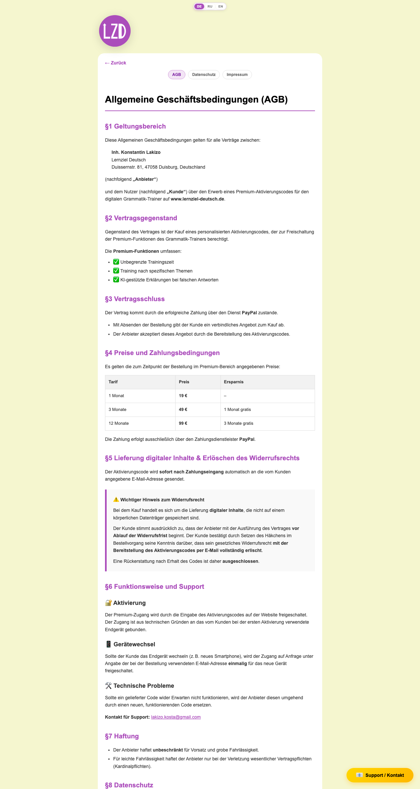
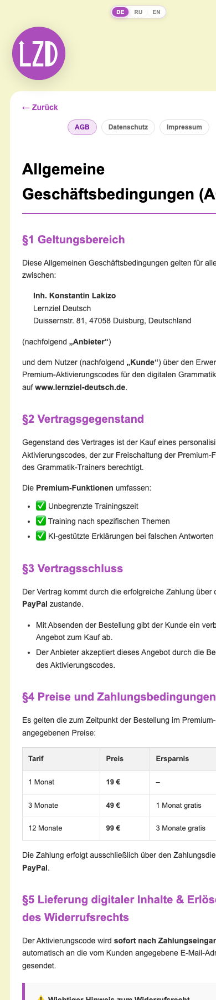
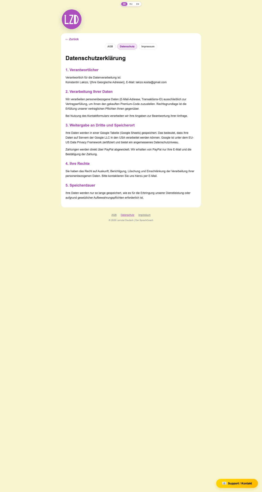
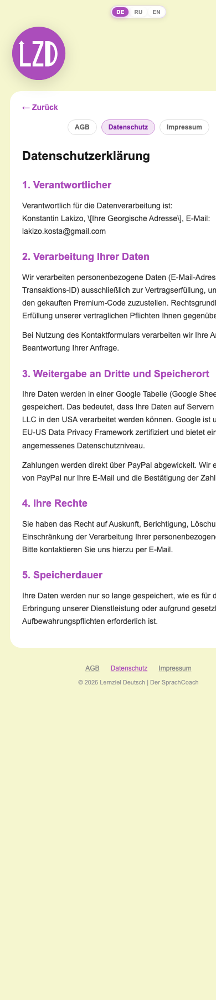
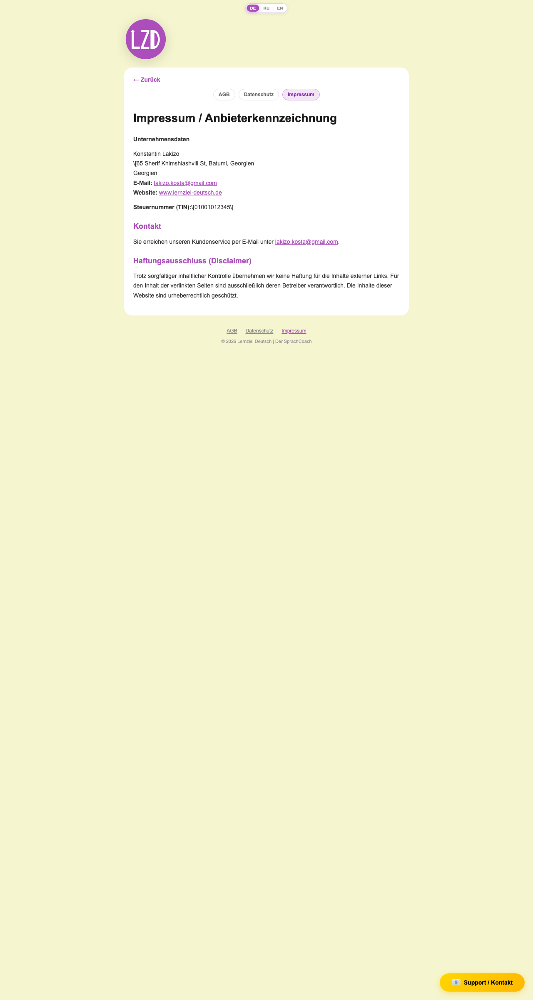
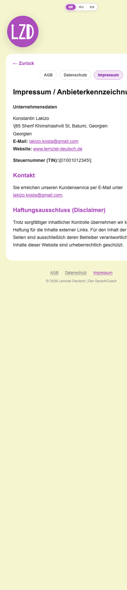

# 05 — Legal pages (`/legal/:slug`) + LegalFooter

Source: `src/site/views/Legal.vue`, `src/site/components/LegalFooter.vue`, `src/site/data/legalContent.js`, content in `docs/extra.md`.

| Desktop | Mobile (390 px) |
|---|---|
|  |  |
|  |  |
|  |  |

---

## 1. Route & access

| Item | Value |
|---|---|
| Path | `/legal/:slug(agb|datenschutz|impressum)`, name `legal`, `props: true` — `src/site/router/index.js:30-35` |
| Valid URLs | `#/legal/agb`, `#/legal/datenschutz`, `#/legal/impressum` |
| Invalid slug | e.g. `#/legal/foo` does not match the route regex, so the catch-all redirects it to `landing` (`src/site/router/index.js:36`) |
| Query params | None used |
| Guards | None. The global `beforeEach` does not touch `legal` (`src/site/router/index.js:43-59`). |
| Access | Public and identical for free, Basis, Premium, logged-in users and no-backend mode. The App-shell bootstrap overlay (`src/site/App.vue:42-52`) still covers the page while entitlements load. |

## 2. Purpose

Shows the statutory legal texts (Terms of Service, Privacy Policy, Imprint) required for selling Premium codes. The text is rendered verbatim from the Blogger original in `docs/extra.md` (`src/site/data/legalContent.js:1-4`). The page also gives tab navigation between the three texts and a way back home.

## 3. Layout (top to bottom)

App shell (see `01-landing.md` §4.6): the LocaleSwitcher at the top, the Support FAB at bottom right, no Anmelden FAB.

1. **LzdLogo** in small (104 px) mode (`src/site/views/Legal.vue:32`). Left-aligned in the screenshots.
2. **Legal card** (`.legal-card.card`, white, rounded):
   1. “← Zurück” text button (top left)
   2. Pill nav: **AGB · Datenschutz · Impressum**, with the current page highlighted (`.active`)
   3. `<article class="legal-body legal-body--html">` containing the HTML text: H1, sections, tables, callouts
3. **LegalFooter**: links AGB · Datenschutz · Impressum, then “© 2026 Lernziel Deutsch | Der SprachCoach”. The current link gets `router-link-active` styling (`src/site/styles/main.css:4097-4098`).

Content sections (from `docs/extra.md`):
- **AGB** (`docs/extra.md:23-103`): H1 “Allgemeine Geschäftsbedingungen (AGB)”; §1 Geltungsbereich, §2 Vertragsgegenstand, §3 Vertragsschluss, §4 Preise und Zahlungsbedingungen (table: 1 Monat 19 €, 3 Monate 49 € (1 Monat gratis), 12 Monate 99 € (3 Monate gratis)), §5 Lieferung digitaler Inhalte & Erlöschen des Widerrufsrechts (⚠️ callout), §6 Funktionsweise und Support (Aktivierung / Gerätewechsel / Technische Probleme), §7 Haftung, §8 Datenschutz, §9 Schlussbestimmungen.
- **Datenschutz** (`docs/extra.md:1-22`): H1 “Datenschutzerklärung”; 1. Verantwortlicher, 2. Verarbeitung Ihrer Daten, 3. Weitergabe an Dritte und Speicherort, 4. Ihre Rechte, 5. Speicherdauer; “Stand: 2026”.
- **Impressum** (`docs/extra.md:104-122`): H1 “Impressum / Anbieterkennzeichnung”; Unternehmensdaten (name, address, e-mail and website links), Steuernummer (TIN), Kontakt, Haftungsausschluss (Disclaimer).

## 4. Elements & behavior

| Element | Content | Interaction / result |
|---|---|---|
| Logo | LZD SVG, `small`; title/aria “Zur Startseite” | Click / Enter / Space → `/` (`src/site/components/LzdLogo.vue:21-23`) |
| “← Zurück” | Hard-coded “← Zurück” (`src/site/views/Legal.vue:35`), not i18n (an equivalent key `common.back` exists) | `router.push({name:'landing'})` — always goes to Landing, not browser back (`:25-27`) |
| Nav pills | “AGB”, “Datenschutz”, “Impressum” from the hard-coded `navLabel` map (`:19-23`); `aria-label="Rechtliche Seiten"` | `router-link` to `{name:'legal', params:{slug}}`. Active pill = current slug. Each navigation scrolls to the top (router `scrollBehavior`). |
| Article | Raw HTML from `getLegalPage(slug).html` via `v-html` (`:50`) | Contains `mailto:` links (lakizo.kosta@gmail.com) and an external link to www.lernziel-deutsch.de |
| Not-found card | “Seite nicht gefunden.” + “← Zurück zur Startseite” (hard-coded, `:53-56`) | → Landing. Only reachable if a section marker is missing from `docs/extra.md`, because the router regex already rejects unknown slugs. |
| LegalFooter links | “AGB” · `common.agb`, “Datenschutz” · `common.privacy`, “Impressum” · `common.imprint` (`src/site/components/LegalFooter.vue:10-12`) | `router-link` to the respective legal route |
| LegalFooter copyright | “© 2026 Lernziel Deutsch | Der SprachCoach” · `common.copyright` | — |
| Support FAB | “📧 Support / Kontakt” | Opens ContactModal (see `01-landing.md`) |
| Anmelden FAB | — | Not shown: route ≠ landing/premium (`src/site/App.vue:31-36`) |
| LocaleSwitcher | DE/RU/EN | Changes only the footer strings and app chrome. The legal body, nav pills and back buttons stay German. |

## 5. States & variants

| State | Behavior |
|---|---|
| Free / Basis / Premium / logged-in | Identical |
| No-backend demo | Identical (no API calls) |
| Bootstrap loading | The shell overlay “Zugriff wird geprüft…” covers the page for at most about 4 s when a backend exists |
| Backend degraded | The shell amber banner is shown on top |
| Valid slug | Card with back button, nav and article |
| Content missing | Not-found card |
| Mobile | Same structure; the card is full-width. The pill nav fits on one row. Screenshot `legal-impressum-mobile.png` shows the card and H1 clipped at the right edge (see §9). |
| Locale RU/EN | The footer link labels and copyright are translated; the legal text stays German |

## 6. Data & persistence

- **Content:** `docs/extra.md` is imported at build time as a raw string (`?raw`, `src/site/data/legalContent.js:6`). It is split into pages by the markers `**Datenschutz**`, `**AGB**` and `**Impressum**` in that order: each section runs from its marker to the next marker or end of file (`:9-13,30-44`). `unescapeBloggerHtml` only replaces `\<`, `\>` and `\#` (`:22-24`).
- `LEGAL_SLUGS = ['agb','datenschutz','impressum']` sets the nav order (`:48`).
- No composables except i18n (footer), no localStorage, no API calls.

## 7. Navigation

| In | From |
|---|---|
| `LegalFooter` | Landing, Legal, and any other view that renders it |
| ConversionSheet AGB checkbox link | `src/site/components/ConversionSheet.vue:261` → `/legal/agb` |
| Nav pills | Between legal pages |
| Direct URL | `#/legal/<slug>` |

| Out | To |
|---|---|
| Logo, “← Zurück”, “← Zurück zur Startseite” | `/` (Landing) |
| Nav pills / footer | Other legal pages |
| Article links | `mailto:` / external website |
| Support FAB | ContactModal (overlay) |

## 8. Acceptance criteria

1. `#/legal/agb` shows a card whose H1 is “Allgemeine Geschäftsbedingungen (AGB)”, with the “AGB” pill highlighted and sections §1–§9 rendered as HTML (not as escaped `\<…\>` text).
2. `#/legal/datenschutz` shows H1 “Datenschutzerklärung” with sections 1–5, and the “Datenschutz” pill highlighted.
3. `#/legal/impressum` shows H1 “Impressum / Anbieterkennzeichnung”, a clickable `mailto:` link and a link to www.lernziel-deutsch.de, and the “Impressum” pill highlighted.
4. `#/legal/xyz` redirects to `#/`.
5. Clicking another pill switches the content without a full reload and scrolls to the top.
6. “← Zurück” always navigates to `#/`, even when the page was opened by a direct link or from another legal page.
7. The footer on every legal page shows the three links and “© 2026 Lernziel Deutsch | Der SprachCoach”. The link for the current page is styled active.
8. The Support / Kontakt FAB is visible and the Anmelden FAB is not.
9. Switching the locale to EN changes the footer labels to their EN equivalents. The page does not break.
10. The AGB checkbox link in the Premium bottom sheet opens `#/legal/agb`.
11. At 390 px width the legal card fits the viewport with no clipped text (currently failing per screenshot — see §9).

## 9. Open questions / observations

1. **Placeholder and escape artifacts in the published legal text:**
   - Datenschutz §1 contains the literal placeholder “[Ihre Georgische Adresse]” (`docs/extra.md:7`).
   - Impressum shows “\\[65 Sherif Khimshiashvili St, Batumi, Georgien” with a stray backslash and an unclosed bracket, followed by a duplicated “Georgien” line (`docs/extra.md:110-111`).
   - The TIN shows as “\\[01001012345\\]” (`:116`), which looks like a placeholder value.
   - Cause: `unescapeBloggerHtml` does not unescape `\[` and `\]` (`src/site/data/legalContent.js:22-24`).
2. **Contradictory legal facts:**
   - The AGB names the provider at “Duisserstr. 81, 47058 Duisburg, Deutschland”, while the Impressum gives Batumi, Georgia.
   - AGB §3/§4 and Datenschutz §3 say payment is made **exclusively via PayPal**, but the app also offers Stripe (cards, Apple Pay, Google Pay) and a 4.99 € Basis plan that the AGB price table does not list.
   - AGB §6 says access is bound to one device and transferred “einmalig” on request, while the app advertises magic-link login on up to 2 devices.
   - Datenschutz does not mention Stripe, the device ID (`deviceId` in localStorage/cookie), localStorage progress data, magic-link session tokens or the contact-form page URL capture.
3. **Stray markup:** the Datenschutz chunk ends with an unmatched `
` (`docs/extra.md:21`). The AGB chunk carries inline styles (`color: #000` etc.) that ignore app theming.
4. **`v-html` of the file content** (`src/site/views/Legal.vue:50`): acceptable because the content is build-time and trusted, but any HTML in `docs/extra.md` (scripts, iframes) would execute.
5. **Not translated:** “← Zurück”, the nav labels, “Seite nicht gefunden.” and the aria-label are hard-coded German, even though i18n keys exist (`common.back`, `common.agb`, `common.privacy`, `common.imprint`). The legal bodies have no RU/EN versions.
6. **“← Zurück”** always goes to Landing, so a user who came from the Premium sheet loses that context (the sheet state is gone).
7. **Mobile clipping:** in `legal-impressum-mobile.png` and `legal-agb-mobile.png` the card and H1 run past the right edge, and `html`/`body` `overflow-x: hidden` hides the overflow (`src/site/styles/main.css:12-25`). Long unbreakable words (“Anbieterkennzeichnung”) and the AGB table likely need wrapping or `overflow-wrap: anywhere`. This needs verifying on a real device.
8. **Unreachable branch:** the not-found card can only appear if `docs/extra.md` loses a marker. Because markers are found with `indexOf` in a fixed order, renaming a heading in `docs/extra.md` would silently merge two pages.
9. **Copyright year** “© 2026” is hard-coded in each locale (`src/site/i18n/locales/de.js:26`).
